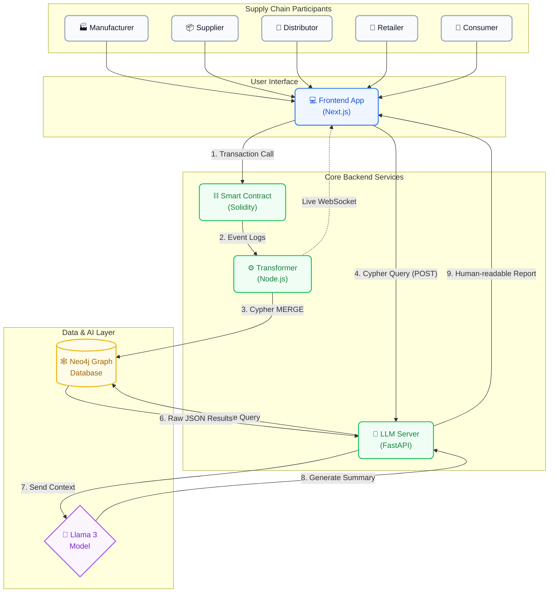

# Knowledge Representation with Blockchain in Supply Chain

A blockchain-based knowledge representation framework that integrates Ethereum smart contracts, a Neo4j knowledge graph, and a locally hosted Large Language Model to enable secure, structured, and queryable supply chain data management.

## Overview

This system tracks the movement of goods across a supply chain — from manufacturer to consumer. Every product movement is recorded as an immutable event on the Ethereum blockchain via a Solidity smart contract. A Node.js transformer service listens for these events, decodes them, and stores them as interconnected nodes and relationships in a Neo4j knowledge graph. A Next.js frontend deterministically generates exact Cypher queries, which are executed by a Python server. Finally, a locally hosted Large Language Model (Llama 3) interprets the raw JSON results to provide users with a human-readable, AI-generated supply chain report.

## Architecture



## Data Flow & System Architecture

This section explains how data moves through the system and how Neo4j integrates with the smart contract.

### The Complete Data Flow

When a product moves through the supply chain, here is what happens:

#### Stage 1: Smart Contract Emits Events

When you register an actor or transfer a product, the smart contract emits an immutable event on the blockchain:

```text
User initiates transaction (e.g., transfer product)
  ↓
Smart contract executes business logic
  ↓
Contract emits event (ProductTransferred, ActorRegistered, etc.)
  ↓
Event is recorded on the Hardhat blockchain
```

These events are the **single source of truth** for all supply chain activity.

#### Stage 2: Transformer Listens and Processes

The transformer service constantly listens to the blockchain and processes each event:

```text
Transformer listener detects event from blockchain
  ↓
Decoder: Converts raw event data to structured format
  ↓
Validator: Checks data quality using Joi schemas
  ↓
Enricher: Adds context and metadata
  ↓
AnomalyChecker: Detects suspicious patterns
  ↓
GraphMapper: Converts to Neo4j node/relationship structure
```

This pipeline ensures that only clean, validated, enriched data reaches Neo4j.

#### Stage 3: Transformer Writes to Neo4j

After processing, the transformer writes to the knowledge graph:

```text
GraphWriter connects to Neo4j
  ↓
Creates/Updates nodes:
  - Actor (Manufacturer, Supplier, Distributor, Retailer, Consumer)
  - Product (the physical items being tracked)
  - Transfer (individual transfer records)
  - Recall (recall events)
  ↓
Creates/Updates relationships:
  - MANUFACTURED_BY: Product → Actor (manufacturer)
  - CURRENTLY_OWNED_BY: Product → Actor (current owner)
  - TRANSFERRED_FROM: Transfer → Actor (sender)
  - TRANSFERRED_TO: Transfer → Actor (recipient)
  - TRANSFER_OF: Transfer → Product
  - RECALLED: Recall → Product
```

**Important:** Neo4j does NOT directly read from the blockchain. The transformer is the bridge between them.

#### Stage 4: Real-Time Broadcasting

Simultaneously, the transformer broadcasts events to connected frontend clients via WebSocket:

```text
WebSocket emitter receives processed event
  ↓
Formats as JSON message
  ↓
Broadcasts to all connected clients
  ↓
Frontend receives update in real-time
  ↓
Dashboard updates without page refresh
```

This enables live dashboards that reflect supply chain activity as it happens.

#### Stage 5: Frontend Queries and LLM Interprets

When a user wants to view product insights or trace a transaction:

```text
User: Clicks "Graph Insights" on a product
  ↓
Frontend generates the exact Cypher query locally
  ↓
Frontend sends Cypher query to Python LLM server
  ↓
Python server executes query directly against Neo4j
  ↓
Neo4j returns structured JSON results
  ↓
Python server prompts Llama 3: "Explain this JSON data to the user"
  ↓
Llama 3 formats raw data into a human-readable summary
  ↓
Frontend displays both the Cypher query (for transparency) and the AI explanation
```

**Why this design?** The LLM does not generate Cypher queries. This prevents AI hallucinations, guarantees 100% deterministic database queries, and restricts the LLM purely to its strength: interpreting data into natural language.

#### Stage 6: Visualization (Optional)

The frontend can optionally visualize the Neo4j graph:

```text
Frontend requests graph data (via LLM or direct Neo4j query)
  ↓
Receives nodes and relationships
  ↓
Renders interactive graph visualization:
  - Nodes as circles (actors/products)
  - Edges as connections showing relationships
  - Color coding for different node types
  - Timeline of transfers
```

### How Neo4j Fits Into the Architecture

Many users ask: **"Does Neo4j read directly from the smart contract?"**

**Answer: No.** Here's why and what happens instead:

#### The Bridge: The Transformer Service

Neo4j cannot read from the blockchain directly. Instead:

1. **Transformer reads blockchain** via ethers.js RPC connection
2. **Transformer processes events** through the pipeline
3. **Transformer writes to Neo4j** via neo4j-driver
4. **Neo4j stores processed data** as a structured knowledge graph

Think of the flow as:

```text
Raw blockchain events (hard to interpret)
  ↓
Transformer (interprets and structures the data)
  ↓
Neo4j (organized knowledge graph)
  ↓
LLM + Frontend (query and visualize)
```

Neo4j becomes the **processed data store** that is optimized for complex supply chain queries.

#### Why This Design?

**Advantages of this architecture:**

1. **Data Quality** — Transformer validates all data before writing
2. **Flexibility** — Data can be enriched, transformed, or filtered
3. **Performance** — Neo4j can answer complex queries faster than blockchain
4. **Separation of Concerns** — Blockchain stores immutable events; Neo4j stores queryable knowledge
5. **Real-time Updates** — WebSocket emitter provides live updates
6. **Anomaly Detection** — Transformer can flag suspicious patterns before they reach Neo4j

#### Example: A Complete Product Journey

Let's trace a single product from creation to consumer:

```text
1. SMART CONTRACT:
   - Manufacturer creates Product #1
   - Event: ProductCreated(id=1, name="Smartphone", manufacturer=0x111...)
   
2. TRANSFORMER LISTENER:
   - Hears the event
   - Decodes: {productId: 1, name: "Smartphone", ...}
   - Validates: All fields are correct format
   - Enriches: Adds timestamps, chain ID
   - Detects: No anomalies
   
3. NEO4J WRITER:
   - Creates node: Product {id: 1, name: "Smartphone", status: "Created"}
   - Creates relationship: Product -[MANUFACTURED_BY]-> Actor {id: 0x111..., role: "Manufacturer"}
   - Creates relationship: Product -[CURRENTLY_OWNED_BY]-> Actor {id: 0x111...}
   
4. WEBSOCKET BROADCAST:
   - Sends {type: "event", data: {type: "ProductCreated", ...}} to frontend
   - Dashboard updates: Shows new product in inventory
   
5. LATER - MANUFACTURER TRANSFERS TO SUPPLIER:
   - Smart contract emits: ProductTransferred(product=1, from=0x111..., to=0x222...)
   - Transformer processes it the same way
   - Neo4j updates:
     * Updates Product status: "InTransit"
     * Updates CURRENTLY_OWNED_BY: Points to 0x222... (supplier)
     * Creates Transfer node with details
   - Frontend shows transfer in real-time
   
6. USER ASKS: "Where is product 1?"
   - LLM queries Neo4j:
     MATCH (p:Product {id: 1})-[:CURRENTLY_OWNED_BY]->(a:Actor)
     RETURN a.name, a.role, a.location
   - Neo4j returns: [{name: "Global Supplies Ltd", role: "Supplier", location: "Singapore"}]
   - LLM responds: "Product 1 is currently held by Global Supplies Ltd in Singapore"
```

### Neo4j Visualization

You can visualize the graph in two ways:

#### 1. Neo4j Browser (Development)

For developers and debugging:

- Access at `http://localhost:7474` when Neo4j is running
- Use built-in Cypher editor
- See visual graph representations
- Test queries interactively

#### 2. Frontend Visualizations (User-facing)

For end users:

- Custom visualizations in the Next.js frontend
- Interactive supply chain maps
- Product journey timelines
- Actor network diagrams
- Real-time updates via WebSocket

---

### 📊 Useful Cypher Queries (Database Analytics)

If you open the Neo4j Browser at `http://localhost:7474`, you can run the following Cypher queries to manually analyze the supply chain data. These are the core queries that power the frontend insights!

#### 1. Track the Complete Journey of a Product
This query traces every single transfer a specific product has gone through, showing exactly who sent it to whom, and when.
```cypher
MATCH (p:Product {id: '1'})<-[:TRANSFER_OF]-(t:Transfer)
MATCH (t)-[:TRANSFERRED_FROM]->(from:Actor)
MATCH (t)-[:TRANSFERRED_TO]->(to:Actor)
RETURN from.name AS Sender, to.name AS Receiver, t.location AS Location, t.timestamp AS Time
ORDER BY t.timestamp ASC;
```
**Output:** A chronological list of transfers (e.g., Row 1: Manufacturer -> Supplier, Row 2: Supplier -> Distributor).

#### 2. Find the Current Owner of a Product
If you just want to know exactly who currently holds the product right now.
```cypher
MATCH (p:Product {id: '1'})-[:CURRENTLY_OWNED_BY]->(a:Actor)
RETURN p.name AS Product, p.status AS Status, a.name AS CurrentOwner, a.role AS OwnerRole;
```
**Output:** One row showing the product name, its status (e.g., "In Transit"), and the specific Actor that holds it.

#### 3. See All Actors Grouped by Role
Want to see how many Manufacturers, Suppliers, and Retailers are registered in the entire system?
```cypher
MATCH (a:Actor)
RETURN a.role AS Role, count(a) AS TotalCount
ORDER BY TotalCount DESC;
```
**Output:** A table showing roles and the number of people registered under each (e.g., 5 Retailers, 2 Manufacturers).

#### 4. Anomaly Detection (Suspiciously Fast Transfers)
This query flags products that were transferred twice within less than 60 seconds. This usually indicates fraud, a system error, or an automated bot moving items unnaturally.
```cypher
MATCH (p:Product)<-[:TRANSFER_OF]-(t1:Transfer)
MATCH (p:Product)<-[:TRANSFER_OF]-(t2:Transfer)
WHERE t1.id < t2.id
AND duration.between(datetime(t1.timestamp), datetime(t2.timestamp)).seconds < 60
RETURN p.name AS SuspiciousProduct, t1.timestamp AS FirstTransfer, t2.timestamp AS SecondTransfer;
```
**Output:** A list of products that moved impossibly fast, serving as a security alert.

#### 5. Trace Products Through a Specific Location
If a specific warehouse burned down or had a contamination issue, you can find *all* products that ever passed through it.
```cypher
MATCH (t:Transfer)
WHERE t.location CONTAINS 'Warehouse'
MATCH (t)-[:TRANSFER_OF]->(p:Product)
RETURN DISTINCT p.id AS ProductID, p.name AS ProductName, t.timestamp AS DatePassedThrough;
```
**Output:** A list of all unique products that were in that specific location.

#### 6. View the Complete Database Schema
If you want to see the "blueprint" of your database (how Actors, Products, and Transfers connect to each other in the abstract), run this command.
```cypher
CALL db.schema.visualization()
```
**Output:** A beautiful visual web showing all the Node labels (Product, Actor, Transfer) and all the possible Relationship lines connecting them (CURRENTLY_OWNED_BY, TRANSFERRED_FROM, etc.). This is perfect for taking a screenshot for your project report!

---
### Summary: The Data Journey

```text
Smart Contract (immutable events)
        ↓
    Blockchain
        ↓
Transformer (listens, validates, enriches)
        ↓
Neo4j (organized knowledge graph)
        ↓
LLM + Frontend (query and visualize)
        ↓
End User (sees supply chain insights)
```

Each layer has a specific purpose:

- **Smart Contract**: Enforce business rules immutably
- **Blockchain**: Record all activity permanently
- **Transformer**: Clean and structure the data
- **Neo4j**: Organize data for complex queries
- **LLM**: Answer questions in natural language
- **Frontend**: Visualize and interact with data

## Features

- **Immutable Product Tracking** — Every movement is recorded on-chain via a Solidity smart contract
- **Knowledge Graph Storage** — Supply chain data is modeled as nodes and relationships in Neo4j
- **Natural Language Queries** — Ask questions in plain English; the LLM translates them to Cypher
- **Anomaly Detection** — Automated fraud and suspicious-pattern detection via graph queries
- **Real-time Event Feed** — WebSocket-powered live transaction updates on the dashboard
- **Wallet Integration** — MetaMask / RainbowKit wallet connection for on-chain interactions

## Technology Stack

| Layer                  | Technology                          |
|------------------------|-------------------------------------|
| Smart Contract         | Solidity 0.8.20 / Hardhat           |
| Blockchain Interaction | ethers.js v6                        |
| Event Processing       | Node.js / ethers.js / Joi           |
| Graph Database         | Neo4j 5.x / neo4j-driver            |
| Frontend Framework     | Next.js 14 / React 18               |
| Wallet Connection      | wagmi v2 / RainbowKit / MetaMask    |
| LLM                    | Llama 3 (local) / LangChain         |
| LLM Server             | FastAPI / Python                    |
| Styling                | Tailwind CSS / shadcn/ui            |
| Local Blockchain       | Hardhat Network                     |
| Database Container     | Docker / Neo4j Docker image         |

## Prerequisites

- [Node.js](https://nodejs.org/) v18+
- [Python](https://www.python.org/) 3.10+
- [Docker](https://www.docker.com/) (for Neo4j)
- [MetaMask](https://metamask.io/) browser extension
- [Git](https://git-scm.com/)

## Installation

**1. Clone the repository**

```bash
git clone <your-repo-url>
# Or if working locally, just navigate to the project folder
cd final-year-project
```

**2. Smart Contracts**

```bash
cd contracts
npm install
npx hardhat compile
npx hardhat node                # Start local blockchain
npx hardhat run scripts/deploy.ts --network localhost
```

**3. Neo4j (via Docker)**

```bash
cd neo4j
docker-compose up -d
```

**4. Transformer Service**

```bash
cd transformer
npm install
cp .env.example .env            # Configure environment variables
node index.js
```

**5. LLM Server**

```bash
cd llm
pip install -r requirements.txt
cp .env.example .env            # Configure environment variables
python server.py
```

**6. Frontend**

```bash
cd frontend
npm install
cp .env.local.example .env.local  # Configure environment variables
npm run dev
```

The app will be available at `http://localhost:3000`.

## Project Structure

```
final-year-project/
│
├── contracts/                              # Stage 2 — Smart contract layer
│   ├── contracts/
│   │   └── SupplyChain.sol                 # Main Solidity contract (523 lines)
│   ├── scripts/
│   │   ├── deploy.ts                       # Deployment script (TypeScript)
│   │   └── seed.ts                         # Test data seeding script
│   ├── test/
│   │   ├── SupplyChain.test.ts             # Contract test suite (TypeScript)
│   │   └── Counter.ts                      # Counter test (Hardhat default)
│   ├── deployments/
│   │   └── localhost.json                  # Deployed contract address + ABI
│   ├── artifacts/                          # Compiled contract artifacts (auto-generated)
│   │   ├── artifacts.d.ts
│   │   ├── build-info/
│   │   └── contracts/
│   ├── cache/                              # Hardhat compilation cache
│   │   └── compile-cache.json
│   ├── ignition/                           # Hardhat Ignition modules
│   │   └── modules/
│   ├── hardhat.config.ts                   # Hardhat configuration (TypeScript)
│   ├── tsconfig.json                       # TypeScript config for contracts
│   ├── package.json
│   ├── package-lock.json
│   ├── .gitignore
│   └── README.md                           # Contracts layer documentation
│
├── transformer/                            # Stage 3 — Event processing layer
│   ├── src/
│   │   ├── config.js                       # Environment & connection configuration
│   │   ├── constants.js                    # Shared constants (event names, roles)
│   │   ├── ingest/
│   │   │   └── listener.js                 # Listens to contract events via ethers.js
│   │   ├── pipeline/
│   │   │   ├── index.js                    # Orchestrates all pipeline stages
│   │   │   ├── decode.js                   # Decodes raw event logs
│   │   │   ├── validate.js                 # Validates decoded data with Joi schemas
│   │   │   ├── enrich.js                   # Adds context and metadata
│   │   │   ├── mapToGraph.js               # Maps data to Neo4j node/relationship structure
│   │   │   └── anomalyCheck.js             # Detects suspicious patterns
│   │   ├── neo4j/
│   │   │   └── writer.js                   # Writes nodes and edges to Neo4j
│   │   ├── realtime/
│   │   │   └── emitter.js                  # WebSocket broadcast to frontend
│   │   └── state/
│   │       ├── cursor.js                   # Tracks last processed block number
│   │       └── dlq.js                      # Dead letter queue for failed events
│   ├── dlq/                                # DLQ file storage directory
│   ├── index.js                            # Entry point
│   ├── package.json
│   ├── package-lock.json
│   ├── .env                                # Environment variables
│   ├── .env.example                        # Environment variables template
│   ├── .gitignore
│   └── README.md                           # Transformer layer documentation
│
├── neo4j/                                  # Stage 4 — Knowledge graph layer
│   ├── schema/
│   │   └── constraints.cypher              # Neo4j constraints and indexes
│   ├── queries/
│   │   ├── anomaly_detection.cypher        # Fraud detection Cypher queries
│   │   └── sample_queries.cypher           # Example queries for testing
│   ├── docker-compose.yml                  # Neo4j Docker configuration
│   └── README.md                           # Neo4j layer documentation
│
├── frontend/                               # Stage 5 — Frontend layer (Next.js 14)
│   ├── app/
│   │   ├── layout.tsx                      # Root layout — Sidebar + TopBar shell
│   │   ├── page.tsx                        # Root page — redirects to /dashboard
│   │   ├── globals.css                     # Global styles + design system tokens
│   │   ├── favicon.ico                     # App favicon
│   │   ├── fonts/
│   │   │   ├── GeistVF.woff               # Geist font variable
│   │   │   └── GeistMonoVF.woff           # Geist Mono font variable
│   │   ├── dashboard/
│   │   │   └── page.tsx                    # Command Center — stats, map, event stream
│   │   ├── products/
│   │   │   └── page.tsx                    # Product catalog + create product form
│   │   ├── actors/
│   │   │   └── page.tsx                    # Actor registry + register actor form
│   │   ├── transfers/
│   │   │   └── page.tsx                    # Transfer product between actors
│   │   ├── graph/
│   │   │   └── page.tsx                    # Graph Explorer — SVG node visualization
│   │   ├── chat/
│   │   │   └── page.tsx                    # AI Query Assistant — LLM chat interface
│   │   └── events/
│   │       └── page.tsx                    # Event Log — WebSocket transaction history
│   ├── components/
│   │   ├── Sidebar.tsx                     # Fixed sidebar with LEDGER CORE branding
│   │   ├── TopBar.tsx                      # Top navigation bar + wallet connect
│   │   └── Navbar.tsx                      # Alternative navigation component
│   ├── lib/
│   │   ├── contract.ts                     # Contract address + ABI configuration
│   │   └── wagmi.ts                        # wagmi (wallet) configuration
│   ├── providers/
│   │   └── index.tsx                       # WagmiProvider + QueryClientProvider
│   ├── tailwind.config.ts                  # Tailwind CSS custom theme
│   ├── postcss.config.mjs                  # PostCSS configuration
│   ├── next.config.mjs                     # Next.js configuration
│   ├── next-env.d.ts                       # Next.js TypeScript declarations
│   ├── tsconfig.json                       # TypeScript configuration
│   ├── .eslintrc.json                      # ESLint configuration
│   ├── .env.local                          # Frontend environment variables
│   ├── package.json
│   ├── package-lock.json
│   ├── .gitignore
│   └── README.md                           # Frontend layer documentation
│
├── llm/                                    # Stage 6 — LLM integration layer
│   ├── server.py                           # FastAPI server exposing /chat
│   ├── chain.py                            # LangChain QA pipeline
│   ├── prompts/
│   │   └── cypher_prompt.txt               # System prompt for Cypher generation
│   ├── requirements.txt                    # Python dependencies
│   ├── .env                                # Environment variables
│   ├── .env.example                        # Environment template
│   └── README.md                           # LLM layer documentation
│
├── docs/                                   # Project documentation (planned)
│   │                                       # architecture.md
│   │                                       # api.md
│   │                                       # screenshots/
│
└── README.md                               # This file — project overview & roadmap
```

## Project Objectives

| Objective | Component |
|-----------|-----------|
| Decentralized data security | Hardhat local Ethereum network |
| Smart contract validation | SupplyChain.sol |
| LLM for blockchain data understanding | Llama 3 + LangChain pipeline |
| Knowledge graph for entity representation | Neo4j graph database |
| Knowledge representation from supply chain data | Event Processing Layer + Neo4j schema |

## Roadmap

- [x] **Stage 1** — Development environment setup
- [x] **Stage 2** — Smart contract implementation & deployment
- [x] **Stage 3** — Event processing layer (Node.js transformer)
- [x] **Stage 4** — Neo4j knowledge graph configuration
- [x] **Stage 5** — Frontend implementation (Next.js / React)
- [x] **Stage 6** — LLM integration (Llama 3 / LangChain)
- [ ] **Stage 7** — Testing & verification

## License

This project is part of a final-year academic project and is not currently licensed for public use.
