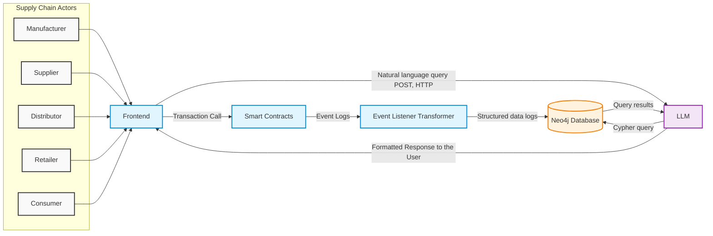
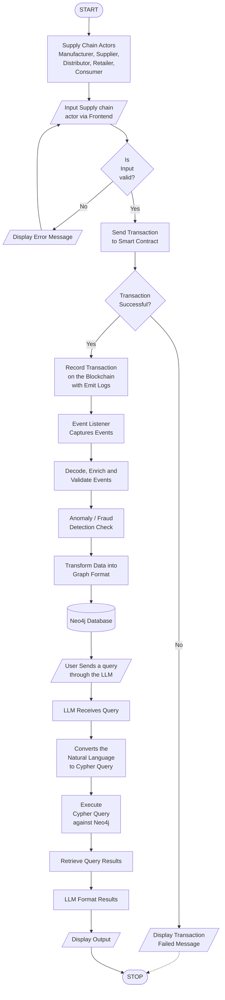

      KNOWLEDGE REPRESENTATION WITH BLOCKCHAIN
                                        IN SUPPLY CHAIN
BY
OLUBUNMI-BROWNS KEHINDE.O
MATRIC NUMBER: 22CD009461

A PROJECT SUBMITTED TO THE DEPARTMENT OF
COMPUTER SCIENCE, COLLEGE OF PURE AND APPLIED
SCIENCES, LANDMARK UNIVERSITY, OMU-ARAN, AND
KWARA STATE, NIGERIA IN PARTIAL FULFILMENT OF
THE REQUIREMENT FOR THE AWARD OF BACHELOR OF
SCIENCE DEGREE IN COMPUTER SCIENCE.

MONTH 2026

DECLARATION
I, OLUBUNMI-BROWNS KEHINDE, hereby declare that the research project submitted for 
evaluation for the award of bachelor of science (b.sc) degree in COMPUTER SCIENCE was carried out by me.

_____________________________ 		                    ______________________________                                 OLUBUNMI-BROWNS KEHINDE                                                     DATE

 
CERTIFICATION
This is to certify that OLUBUNMI-BROWNS KEHINDE with matriculation number 22CD009461 has carried out this research project in partial fulfilment of the requirement for the award of Bachelor of Science Degree in Computer Science in the College of Pure and Applied Sciences, Landmark University. 

_______________________				__________________________
 Mr. Emmanuel Ogbonnia                                                      DATE
Project Supervisor                                

 _______________________				__________________________
  Prof. Ayodele Adebiyi                                                         DATE
  Head of Department

DEDICATION
I dedicate this report to God for His mercies and grace upon the life of I and my Family (THE OLUBUNMI-BROWNS), Friend and Fellow tutors that guided me in this project and providing me resources and guidance in all I can do to be able to implement this project.
 
ACKNOWLEDGEMENT
I want to sincerely appreciate everyone who helped see this project through to completion I am most grateful to God, First and foremost for providing me with wisdom and strength to complete this task, Additionally, I would like to express my gratitude to my supervisor , Mr. Emmanuel Ogbonnia for their steadfastness and dedication towards not just the growth and the deliberate act to build my future, but to build a project that will be able to last forever in my career as problem solver and researcher I am grateful to the faculty and staff of the department of Computer Science , Landmark University whose dedication to teaching and learning provided me the necessary knowledge background and advancements to be able to complete this project. I want to extend my dear thanks to my friends and colleges that helped me on my way to this project I am proud to say thank you for all you have done to bring out the best out of me. And Finally, Thank you all for helping me achieve this milestone. 
 
ABSTRACT
Supply chain management faces persistent challenges including data tampering, lack of transparency and inability of stakeholders to meaningfully interpret transactional records across the distribution chain from manufacturer to consumer. Although block chain technology provides immutability and decentralization, the cryptographic nature of on-chain data makes it difficult for non-technical users to understand. Most existing solutions address data security but fail to provide structured, interpretable representations of supply chain relationships and events. To bridge this gap, this project proposes a secure, structured framework that integrates Ethereum smart contracts with a Neo4j knowledge graph and a locally hosted Large Language Model to provide natural language. A Node.js event processing pipeline acts as a bridge, capturing immutable events from the smart contracts and structuring them as explicit entities and relationships within the knowledge graph. Rather than requiring users to manually write complex cypher code, the integration of LLM accepts English questions based on the connection between the smart contract and the neo4j database with the pipeline using nodejs that helps handles events from the smart contracts. Ultimately, this system combines the use of blockchain features for immutability and merging an llm and knowledge graph to explicitly explain the movement of data based on the quires and also prevent anomaly fraudulent transactions from users.
Keyword: ethereum, ontology, smart contracts, remix-ide, knowledge graph, oracles, node, supply chain, layer-2 
CHAPTER ONE
INTRODUCTION
1.1 Background of Study
The rapid digitalization of global industries has increased dependence on data-driven systems to support complex operations across various sectors. Supply chain management, which involves the movement of goods, resources, and information from manufacturers to end consumers, is one of the areas where digital technologies have become increasingly essential.  Blockchain technology provides a secure and decentralized mechanism for managing supply chain data. Unlike traditional centralized systems, blockchain ensures immutability, transparency, and decentralization, preventing unauthorized modification of records. In conventional paper-based or isolated digital supply chain systems, data is often vulnerable to loss, tampering, and delays. Blockchain significantly reduces these risks by storing data across distributed nodes in a tamper-proof ledger. Oracles play a vital role in blockchain ecosystems by enabling smart contracts to access external data sources. These external data inputs are verified and recorded on the blockchain, ensuring integrity and accountability. Studies have shown that traditional paper-based systems suffer from data fragmentation and inefficiencies (Khawaldeh et al.,2025). For example, integrating blockchain with the U.S. Customs and Border Protection’s Automated Commercial Environment (ACE) can automate origin verification and streamline compliance checks while identifying suspicious transactions (Islam et al., 2025).Artificial Intelligence (AI), particularly Knowledge Representation techniques, addresses this challenge by structuring, classifying, and interpreting data. In supply chain systems involving manufacturers, suppliers, distributors, and consumers, AI enables predictive analysis, reasoning, and intelligent decision-making. Additionally,   Knowledge Graphs play a critical role in enhancing the interpretability and usability of complex data generated within blockchain-based systems. A Knowledge Graph represents data as interconnected entities and relationships using a graph-based structure, enabling semantic understanding and reasoning. In the context of supply chain management, Knowledge Graphs allow entities such as manufacturers, suppliers, distributors, products, and transactions to be explicitly modeled and linked. This structured representation supports advanced querying, traceability, and inference, which are difficult to achieve using traditional relational databases or raw blockchain data alone.
1.2	Statement of Problem
Modern supply chain systems face persistent challenges such as delays, inefficiencies, lack of transparency, and data inconsistency during product distribution from manufacturers to consumers. Blockchain technology addresses many of these issues by providing a decentralized, immutable, and tamper-proof ledger for recording supply chain transactions. However, despite the security offered by blockchain, the stored data is often complex and difficult for users to interpret. The lack of semantic structure limits meaningful analysis and understanding. Furthermore, the interpretability of intelligent models and the high computational resources required for data analysis present additional challenges (Kapadiya et al.,2022; Kaafarani et al.,2023).To address these issues, this project integrates Artificial Intelligence through Knowledge Graphs to represent relationships among supply chain entities. 

1.3	Aim and Objective

The aim of this project is to develop a blockchain-based knowledge representation framework that securely structures, interprets and visualize supply chain data across different stages of the supply chain, and the objectives are:
 
i.	To apply decentralization to enhance data security and scalability.
ii.	To use smart contracts for secure storage and validation of supply chain data. 
iii.	To integrate an LLM to enhance understanding of blockchain data that will be queried.
iv.	To apply Knowledge Graphs for representing supply chain entities using nodes and edges their relationships.
v.        To apply Knowledge representation from the supply chain data.

1.4	 Significance of Study
This project provides a practical framework for integrating AI-driven Knowledge Representation with Blockchain technology to achieve secure, interpretable, and decentralized supply chain data management. It demonstrates how Knowledge Graphs enhance data transparency and visualization while blockchain ensures immutability and trust. The study contributes an architectural model and the use of Neo4j to visualize supply chain records graphically, improving clarity and traceability for stakeholders.

1.5	Scope of Study
This project focuses on the integration of Blockchain technology, Artificial Intelligence and Knowledge Graphs for supply chain data management. Although this project encompasses many features, it has some limitations, and the system needs to evaluate the most important aspect, which is the blockchain. This section provides data that needs to be immutable and secure for the users. However, this raw data cannot be easily understood by non-technical users. Therefore, the project needs a framework for how data can be effectively represented. Using Knowledge Graphs allows for the effective representation of the transactional data obtained from the blockchain system. In addition, a Large Language Model is introduced to provide semantic interpretation of the knowledge graph data.
1.6	Limitation of the Study

We will have to avoid using the mainnet because of the cause of deployment to the mainnet, So we will go with the local test net and deploy it either on a local Hardhat network or Ganache testnet  to reduce the massive amount of gas that would be spent, Because spending on the mainnet requires a whole lot of computational power and a high level of resources to compute the data. There will be heavy duty resources that will be consumed when the data will be stored so we need to effectively manage it so that that data will not be lost. The system will avoid deploying and keeping our .env data outside because we know it consist of  sensitive data which might be misplaced.

1.7	Definition of Terms
i.	 Ethereum: Ethereum is a decentralized, open-source block chain platform that acts as a "world computer" for running smart contracts and decentralized applications (dApps)
ii.	 Hyper-Ledger:  A database that provides all details of data deployed on the block chain, forming a chain of nodes
iii.	Knowledge graphs: A structured representation of entities and their relationship, enabling sematic reasoning and querying of interconnected data.
iv.	 Layer-2: They are block chain based system called rollups that are built on top layer one this helps data to follow the ethereum trilemma
v.	Node: A node is a participant in a blockchain network that stores and validates a copy of the distributed ledger
vi.	Ontology: The explicit representation of knowledge within a domain, defining concepts,         their properties, and relationships
vii.	Oracles: Are on-chain data feed that are used to connect smart contract to external data since the smart contract it allows to communicate with the external data
viii.	Remix-IDE: An online development environment for writing, testing and deploying smart contract on test nest or the main net
ix.	Smart-contract: Smart contracts are self-executing programs deployed on the ethereum blockchain that automatically enforce predefined rules and conditions.
x.	Supply-Chain: Is the distribution mechanism that allows product, goods or services to move from one place to another

		CHAPTER TWO
LITERATURE REVIEW
2.1 Knowledge Representation 
 Knowledge Representation refers to the formal modeling of real-world information in a structured manner that enables both human understanding and machine reasoning. It is a fundamental area of artificial intelligence concerned with how knowledge about entities, relationships, rules and processes can be encoded so that computational systems can reason, infer and make decisions. Other knowledge representation techniques include logic-based representations, semantic networks, ontologies and rule-based systems. These techniques allow systems to represent domain knowledge in a meaningful and interpretable form rather than as raw data. In complex sectors such as supply chain management where multiple actors, products, locations, and transactions interact dynamically, structured data alone is insufficient for effective reasoning and decision-making. Recent advances in artificial intelligence have expanded knowledge representation beyond symbolic method to include graph-based and embedding-based representation. These modern approaches enable scalable modeling of large, interconnected datasets while preserving semantic meaning. Knowledge representation therefore serves as the foundation for intelligent systems that require reasoning, explain ability, and structured understanding of data. Recent research have been proposed hybrid architectures where transactional data are stored on-chain while sematic information is maintained off-chain to improve scalability and reasoning capabilities. For example (Olatunji et al ., 2024) demonstrate that hybrid architectures can handle large transaction volume without compromising system performance .

 
Figure 2.1 Knowledge Representation in AI and Its Significance in Business (Vishnu Narayan, 2023

2.2 Knowledge Graphs in Knowledge Representation

 Knowledge Graphs are a core modern approach to knowledge representation. A Knowledge Graph models information as a graph composed of nodes (entities) and edges (relationships), allowing complex relationships to be represented explicitly and intuitively. Entities may represent real-world objects such as products, organizations, locations, or uses while relationships capture interactions such as ownership, transfer and delivery. Knowledge graphs provide several advantages:
i.	 Explicit semantic relationships
ii.	 High flexibility and extensibility
iii.	 Efficient querying of interconnected data
In supply chain contexts, knowledge graphs can represent the entire lifecycle of a product from    manufacturing to final delivery while preserving relationships among stakeholders. Graphs databases such as Neo4j are used to store and query knowledge graphs. We have the different types of knowledge graphs which includes:
i.	Logical Reasoning Models: These models defines formal rules on how entities and relationships interacts.
ii.	Semantic Reasoning: Semantic networks represents knowledge using graphs where nodes are concepts and edges describe relationships between them.
iii.	Ontologies: Ontologies define a shared vocabulary for a specific domain, including entity types, properties , and the rules governing their relationships. 
 
Figure 2.2 Building Intelligent Supply Chain Application with Neo4j (Tara Jana 2022) 

2.2.1 Integration of Knowledge Graphs with Large Language Models
 Large Language Models are particularly useful for generating data based on datasets. However there have been a lack of domain knowledge and factual grounding. Integrating LLMs with knowledge graphs addresses this limitation by grounding language generation in structured, domain-specific knowledge. These features include 
i.	Knowledge graphs provides factual accuracy.
ii.	LLMs enables natural language querying and explanation
iii.	The combined system improves interpretability, explain ability, and user interaction

 
Figure 2.3 Opportunities and Challenges in fusion of knowledge graphs and large language models (Linyue Cai , Chaojia Yu 2025)

2.3 Blockchain Technology
 Blockchain is a decentralized and distributed ledger technology designed to securely store and manage data across a network of nodes. Data are recorded in blocks that are cryptographically linked, ensuring transparency, resistance to tampering and traceability. In blockchain systems, transactions are validated thought a consensus mechanism and replicated across all participating nodes. This eliminates the need for centralized authorities and enhances trust among participants.

 
Figure 2.4 Blockchain Fact (Doretha Clemon 2025)

2.3.1 Types of Blockchain

 Blockchain consist of different types which include
i.	Public Blockchain: These blockchain are completely open to following the idea of decentralization. They do not have any restrictions, anyone having a computer and internet can participate in the network
ii.	Private Blockchain: These blockchain are not as decentralized as the public blockchain only selected nodes can participate in the process, making it more secure than the others
iii.	Hybrid Blockchain: It is the mixed content of the private and public blockchain, where some part is controlled by some organization and other makes are made visible as a public blockchain
iv.	Consortium Blockchain: It is a creative approach that solves the need of the organization. This Blockchain validates the transaction and also initiates or receives transactions

 
Figure 2.5 Types of Blockchain Technology, (Noah Fields 2025)

   

2.4 Challenges of Knowledge Representation and Blockchain 
Despite its advantages, blockchain faces several challenges when applied to knowledge-rich domains such as healthcare, oil and gas and supply chain managements. While blockchain ensures secure data storage, it does not provide mechanisms for semantics interpretation or contextual understanding of stored data. Consequently, without being able to derive meaningful insight from it. Additionally, blockchain networks often suffer from scalability limitations, interoperability challenges, and high energy consumption. Different blockchain platforms are designed using distinct protocols and frameworks, which may restrict cross-system data exchange (Ogeuhi et al., 2024). These challenges highlights the need for complementary technologies that can structures, interpret, reason over blockchain data. Knowledge representation techniques offer a solution by enabling structured modeling of blockchain data, defining the roles of entities, and clarifying relationship between supply chain actors. By combining blockchain with knowledge representation, it becomes possible to build systems that are both secure and semantically meaningful. 

2.4.1 Overview of Supply-Chain Systems

A supply chain refers to the network through which goods, services and information flow from manufacturers to end consumers. It typically involves multiples stages, including production, storage, transportation, distribution and delivery. In traditional supply chain often, results in supply chain distribution are sometimes ineffective, fraud efficient and lacks traceability. Blockchain technology addresses these issues by providing a tamper-proof and transparent ledger for recoding supply chain transactions. When combined with knowledge representation, supply chain data can be structured in a way that preserve relationship among entities and events. This integration enhances visibility and traceability throughout the supply chain (Agarwal et al., 2022). Modern supply chains also leverage digital mechanisms such as tokenization, which converts physical assets into digital representations, enabling ownership tracking and secure transactions (Ho et al., 2022). 

2.5 Features of Supply-Chain

The supply chain encompasses several key functional stages, each involving the movement and management of goods and information.
i.	Manufacturer: The manufacture is responsible for producing goods that will be distributed through the supply chain, from raw materials to finished products .This section has  the ability to be able to create , redesign and reengineer the goods that will be carried out from one place to another, so the manufacture is the one who has the ability to create the products and these products. 
ii.	Warehousing and Inventory Management: Once produced, goods are typically moved to a warehouse or distribution center shared typically moved based on the type of product that is been distributed to the ware house or distribution center. Effective inventory management at this stage involves stocking or tracking data.
iii.	Transportation: Products are transported from the warehouse to intermediaries and ultimately to the consumer to the final access point to the consumer it will be either truck, sea, train, air or road.
iv.	Customer Delivery: The consumer buys the product from a retailers if purchased online , the final steps is the last mile delivery to the customer home
 
Figure 2.6 SupplyChain Flow (Soutik Banerjee, 2023)

 2.5.1 Decentralized Applications with Smart Contracts in Supply Chains
Decentralized Applications (DApps) are applications built on blockchain platforms that interact with smart contracts through frontend interfaces. Smart contracts are self-executing programs deployed on the blockchain that enforce predefined rules without the need for intermediaries. They enable automation, transparency, and trustless execution of supply chain processes. Nick Szabo originally conceptualized smart contracts as digital protocols that formalize and secure relationships over computer networks. In modern blockchain platforms, smart contracts are commonly written in languages such as solidity and deployed on Ethereum Virtual Machine (EVM)-compatible networks. Oracles such as these providers use chainlink providers which enable smart contracts to interact with external data sources, extending their functionality beyond the blockchain. From a knowledge representation perspective, smart contracts can be viewed as rule-based knowledge systems. Their conditional logic (“if–else” rules) encodes domain knowledge and enforces consistent behavior across participants. Researchers have suggested that representing smart contract logic using knowledge graphs and ontologies can improve clarity, verification, and reasoning over blockchain-based systems (Wong et al., 2022).

2.6 Review of Related Works
Chen and Lin (2023) proposed a linguistic-based knowledge representation approach to improve fairness in Delegated Proof of Stake (DPoS) consensus. Their methodology employed Probabilistic Hesitant Fuzzy Linguistic Term Sets (PHFLTS) to represent nuanced voting preferences among nodes, combined with cumulative possibility and lottery-based ranking. Simulation experiments were conducted to compare the proposed approach with baseline consensus mechanisms. The main contribution of this work lies in introducing knowledge representation concepts into blockchain consensus, improving voting accuracy and fairness. However, the study focuses solely on consensus mechanisms and does not address how blockchain data can be structured or interpreted for end-user applications such as supply chains.
Chris (2023) designed a blockchain-based fraud prevention system using smart contracts and compared it with traditional centralized systems. The methodology involved system architecture design, implementation of smart contracts, and performance comparison against legacy fraud prevention approaches. The study demonstrated that blockchain improves automation, transparency, and traceability in fraud detection. However, the limitation of this work is that it does not provide semantic interpretation of stored data, making it difficult for non-technical users to understand transaction relationships.
Pang et al (2025). introduced “ConSense,” a framework that converts smart contracts into graph representations and applies Graph Neural Networks (GNNs) for vulnerability detection. Their methodology involved smart contract graph generation and structure-aware deep learning models, benchmarked on standard vulnerability datasets. This approach  represent smart contract logic as graph , capturing the flow and data dependencies , Also having the ability to be able to analyze large scale of smart contract with thousands of line of code The contribution of this research is its high accuracy in detecting smart contract vulnerabilities. However, it focuses on security analysis only and does not consider supply chain data modeling or user-facing knowledge representation. It fails to bride the gap between technical smart contract analysis and business-level supply chain knowledge representation 
Sober et al., (2024). Proposed this research of an oracle-based off-chain aggregation protocol using Zk-SNARKs to enable secure and efficient cross-chain data transfer. The methodology involved cryptographic protocol design, cost analysis, and comparison with existing cross-chain solutions .The key contribution is achieving constant-cost proof verification and decentralized aggregation. Nevertheless, the system does not address semantic structuring or visualization of the transferred data , limiting its interpretability.

Kasula et al(2025). applied GraphSAGE and attention-based GNN models to classify Ethereum addresses for enhanced security analytics. Their methodology involved training hybrid models on real blockchain datasets. The research contributes scalable address classification techniques for blockchain analytics. Its limitation is that it treats blockchain data primarily as graphs for classification, without integrating ontology-based knowledge representation or supply chain context.
 Zafer & Ali, (2025) this study is adopted as literature-based methodology comparing traditional fraud detection systems with blockchain and AI-driven approaches. The authors highlighted how blockchain combined with AI enables real-time fraud detection and secure data protection. However, the study is largely conceptual and lacks implementation details or structured data models such as knowledge graphs.
Umea Conference, (2024) this work reviewed existing blockchain applications in supply chain management through case studies and literature analysis. The contribution lies in mapping blockchain benefits such as transparency and traceability. However, it does not propose a technical framework for semantic data representation or intelligent querying of supply chain data.
Alsamani and Bechmann (2023) These authors conducted a systematic literature survey on integrating blockchain with semantic web technologies. Their methodology involved database filtering, classification, and trend analysis. This work identified open challenges and research opportunities in blockchain-semantic integration. Its limitation is that it remains theoretical and does not implement a working system.
Zhang et al. (2020) proposed a zero-knowledge oracle protocol enabling privacy-preserving proofs of web data for smart contracts. The contribution is strong cryptographic assurance for external data feeds. However, the system does not provide semantic interpretation or graphical representation of retrieved data
Mendi (2022) proposed the introduction of a hybrid framework combining LSTM neural networks with blockchain-based proof-of-learning consensus. The study improved sentiment classification accuracy and auditability. Its limitation is that it targets social media analytics rather than supply chain data interpretation.
Gaur. (2024)This research reviewed existing blockchain-based fraud detection methods and proposed a conceptual Ethereum framework using smart contracts. While it highlights blockchain’s benefits for fraud prevention, it lacks implementation details and semantic data modeling techniques.
Neo4j Labs and Solana Foundation (2025) this work exported Solana smart contract interfaces into Neo4j for graph-based auditing. Graph algorithms were applied to detect vulnerabilities. The contribution is real-time contract analysis using knowledge graphs. However, the study focuses on auditing rather than supply chain traceability. Assigned risk scores based on graph topology and function call patterns, Direct connection to Solana RPC nodes for on-chain data retrieval, These ensures interactive graph visualization for security auditors. The Focus exclusively on vulnerability detection , ignoring supply chain business processes natural language querying for non-technical users.It also does not model temporal evolution of supply chain states. 
Tsinghua and Neo4j (2025) this research applied Graph Attention Networks to Neo4j contract graphs for vulnerability detection. Its limitation is the narrow focus on security rather than broader knowledge representation across business processes. The methodology extracts Anchor IDL and Solana program bytecode into Neo4j schemas, weighting risky function call patterns reentrancy, governor exploits through attention mechanisms. Its primary broader business modeling from procurement – manufacturing – logistics essential for supply chain stakeholders. There have been targets on smart contract with vulenrabilites under this sector not integrated with external database ERP , WMS, It limitaions includes that it is limitaed to Solana Anchor Framework. This gap pirotizes code level security over business-level supply chain modeling , sematic knowledge reprsentation and user-accessible querying this research 
Chainlink Labs and Neo4j (2025) this study combined IoT data, Neo4j graphs, and AI embedding’s for end-to-end supply chain traceability. While effective, it relies heavily on IoT infrastructure and does not emphasize user-friendly semantic explanations. The system processes 10k temperature/ shipment event per second with 40% faster Cypher queries than SQL joins, enabling end-to-end traceability from far to retailer. However, heavy IoT infrastructure. This Can not enforce automated agreement or payments based on conditions. While demsotrating Neo4j supply chain capabilities , it lacks blockchains immutability and does not emphasize natural language explanation for business user 
Anaza, Neo4j (2025) proposed the model validator networks in Neo4j and optimizing consensus paths using AI. The limitation is that it focuses on consensus efficiency rather than knowledge representation for users. This helps in the improvement of blockchain conseuns efficiency by modeling validators networks as graph and using AI to optimize validators selection selectors and conseuns path. This research is been proposed to be able to allow data from blockchain data to be graphical using Neo4j it allow data to be represented,  
Swansea University and Neo4j (2025) this research integrated RDF semantics with Neo4j and AI-driven query generation for cross-chain supplychains. While interoperable, the system complexity and reliance on multiple standards increase implementation overhead. The framework support federated queries across Ethereum , Solana and Polygon networks, automatically translating semantics web standards (RDF triples) into Neo4j path traversals (Alsamani and Benchmann, 2023). While demonstrating natural language interfaces for supply chain managers

US Berkeley and Chainalysis (2024) this study applied GNNs and anomaly detection to blockchain transaction graphs for fraud detection. The contribution is high fraud detection accuracy, but it does not focus on explainable knowledge representation for end users. Real-time alerting reduced investigation time by 70%, with Cypher queries revealing money laundering paths spanning 6 months. While technically robust, the approach prioritized forensic analysis over explainable knowledge representation, leaving end-users without intuitive relationship visualizations item- batch – fraudulent claim. We will be pirotizing invesitigation over prevention or user education, The limitation can be Item batch claim relationship in supply chain fraud , product authenticity verification , supply credibility assessment, Rquires Cypher expertise to query , Also graph repsrent transactions , not business entities and their meaning , Also detect fraud after occurrence , does not enable proactive traceability.

2.1 Summary of Related Works 

S/N
(A)	Authors
(B)	Methodology
(C)	Limitations
(D)	Contributions
(E)
1	Yixia Chen and Mingwei Lin, College of Computer and Cyber Security , Fujian Normal University (2023)	Developed PHFLTS for nuanced voting And node selection in DPos ; cumulative possibility and lottery-based ranking; simulation vs. baseline algorithm	Simulation-only (no testnet); 3x computational overhead; lottery collusion risks; cultural linguistic bias	Fine-grained voting method , improved fairness and accuracy for blockchain consensus outperforming existing methods
2	Emmanuel Chris; Lagos State University(2023)	Designed blockchain fraud prevention system (architecture, smart contract , comparison to legacy system)	High gas costs for micro-fraud; smart contract contract bugs; Nigeria-specific; no enterprise integration	Demonstrated effectiveness of blockchain for automation , transparency , and reduction of fraud ; noted industry challenges and recommendations
3	Yan Pang et al.; Guangzhou University Tsinghua University China (2025)	“ConSense” combines smart contract graph generation with structure-aware GNN (Explore Former); benchmarking on vulnerability datasets	EVM/Solidity only; quadratic graph build time GPU decency; zero-day false negatives	
Enhanced preservation of code structure/semantic for smart contract graphs , top precision in vulnerability detection , scalable and real-time solution for blockchain security
(A)	(B)	(C)	(D)	(E)
4	Michael Sober (Hamburg Univ.), Giulia Scaffino (Ti Wien), Stefan Schulte (Hamburg Univ.)(2024)	Oracle-based off-chain aggregation protocol using zk-SNARKS; compared with existing cross-chain , relay solutions ; cost and security evaluation
	zk trusted setup; 15-45s latency; oracles flash loans risks; proofs gen 2-5s 	Enables efficient cross-chain data transfer with constant proof cost , decentralized aggregation , and benchmarked open source implementation
5	Vinay Kumar Kasula et al.; University of the Cumberlands USA (2025)	Hybrid Mylti-class address classification using Graph SAGE, attention , and balance models tested on Ethereum datasets	Ethereum-only patterns; need labeled data; adversarial evearsion 3-hop limit	Scalable and accurate Ethereum address classification , superior to ML baselines improves analytics and security
(A)	(B)	(C)	(D)	(E)
6	Tanvir Zafer, Khalid Ali (2025)	Literature-based research comparing traditional and blockchain/AI-driven fraud/data protection systems	No implementation; ignores chain vulnerabilities; AI drift; high compute costs	 Show blockchain +AI enables real-time robust anti-fraud /data protection ; details advantages, compliance and industry case studies
7	Processing 7th Int. Scientific Conf., Ume Sweden (2024)	Literature and case study review of blockchain adoption and impact in supply chains	Success bias; ignores developing markets; no tech comparisons(vs RFID)	Mapped benefits of blockchain for transparency , traceability , security ; identifies adoption models and barriers

8	Anwar Alsamani Aronld Bechmann; Swansea, University , UK (2023)
	Systematic literature survey (databases, filtering ) mapping integration of blockchain with semantic web technologies 	RDF slows vs Cyper; <1% adoption; misses Rust/Solana; academic focus	Synthesized technical practical and research trends; highlighted open challenges and opportunities for interoperability
(A)	(B)	(C)	(D)	(E)
9	P.Anjaneyulu, M. Soumya , M Sai Kumar , P.Sunil Kumar ; Guru Nanak Institution TC, Hyderabad (2024)	Hybrid system combing deep learning and expert rules for contract vulnerability analysis , code features extraction and validation, tested on real data	Rule maintaince (23%/yr); 2.1GB model size; EVM only	Novel two stage detection system , experimentally superior accuracy and robustness for smart contract security
10	Fan Zhang et al., Cornell Tech , IC3 (2020)
	Proposed and implemented zero-knowledge-based oracle protocol for privacy-preserving proof of TLS web data	TLS 1.2s overhead; 48KB proofs; HTTP only; no post-quantunm	Enabled third-party privacy-preserving proof of web data for smart contracts , published security formalization and functional demonstration
(A)	(B)	(C)	(D)	(E)
11	Arif Furkan Mendi; Havelsan, Ostim Technical Univ.(2022)
	Hybrid Framework using LSTM neural net and blockchain based proof of learning consensus for secure , auditable sentiment analysis 	400x training overhead; LSTM outdated; timing attacks; tweets bias	Improved tweet sentiment classification accuracy , enabled verifiable audit of ML process integrity

12	Varun Gaur, S. Dubey et al.; Affiliation not explicitly specified (likely Indian University , 2024)	Review existing fraud detection and blockchain integration research; proposes a conceptual Etherum-based blockchain framework using smart contracts for fraud validation	Conceptual only; $50/claim gas; legal untested; collusion ignored 	Summarized blockchain’ s benefits for claim fraud prevention (immutability, automation); identifies future research needs and practical system design factors

13	Neo4j Labs and Solana Foundation(2025)	Exports Anchor IDL to Neo4j; Cypher queries for call graphs; GraphSAGE for vulnerability predictions	Misses runtime state; needs labeled data; parallel exec issues	Real time Solana program analysis; 92% reentrancy detection; Rust exporter for your projects
(A)	(B)	(C)	(D)	(E)
14	Light Protocol , Neo4j (2025)	zk-Snarks verify private Neo4js parts; Anchor emits batched proofs ; supply chain case study	zk compile 10-30s path explosion;	Constant-proof cost audits; 88.9% data integrity; Github repo for IoT integration
15 	Tsinghua Univ., Neo4j (2025)	Multi-hop contract graphs in Neo4j; Graphs Attentions Networks; Anchor programs scanning	Overfits EVM; false positives delegatecalls; 50k contract memory 	Outperforms ConSense (entry 3) by 18% F1-Score; Rust tooling for Solana devs; real-time scanning
16	Chain Links Labs, Neo4j (2025)	IoT events to Neo4j via Anchor oracles; GNN embedding for fraud; zk-Snark proofs	Oracle failure points; retrain fraud patterns; scaling complexity	End-to-end traceability;40% faster provenace queries than SQL; open-source Rust clients
 17 	Anza(Solana Core )Neo4j(2025)	Neo4j models validators networks; Rust simulations of conseus path; AI routing optimization	Sim vs mainnet gap; graph staleness; honest majority assumption	<500ms finality in supply chain consuesus; prevents 33% faulty routes; ties to your TowerBFT studies
18	Llamlndex Team(2025)	LLM parses contracts bytecode to Neo4j; RAG for natural language queries ; tested on Etherum/Solana	15% parse inaccuracy obfuscated; RAG halluncinations; vector overhead	Converts complex contracts to queryable graphs; AI chat interface for auditorsscales to 10k+ contracts
(A)	(B)	(C)	(D)	(E)
19	Swansea Univ. Neo4j (2025)	RDF/Neo4j hybrid with smart web; multi-chain oracle aggregation; AI query generation	RDF complexity; 15-60 mins finality; protocol drift	Interoperable supply chain data; natural language Cypher generation; builds on entry 8
20	UC Berkerly, Chain analysis (2024)	Transaction graphs in Neo4j; Graph Neural Networks + anomaly detection; Etherum/Solana datasets	Scarce labels new attacks; 6mo query slowdown; adversarial poisoning 	96% fraud recalls; real-time alerting; extend entries 2,6,12 to graph-based systems 

2.8 GAPS IDENTIFIED FROM RELATED WORKS REVIEWS
 Despite the immutability and transparency provided by blockchain technology, most existing blockchain-based system store data in a form that lacks sematic context and it is difficult for end users to interpret. Current research largely treats blockchain data as raw transaction logs, offering limited support for meaningful understanding of relationships between smart contracts, actors and events, particularly in supply chain environments. Although knowledge graphs have been applied in blockchain security, their use as a real-time semantic layer anchored to deployed smart contracts remained limited. Most existing approaches either focus on static data analysis or operate independently of live on-chain executions (Zheng, Z., Xie, S., 2023 et al.,). Blockchain challenges and opportunities: A survey. International Journal of Web and Grid Services. There is a lack of an integrated framework that links on-chain smart contract data with off-chain knowledge graphs, enabling contextual interpretation, visualization, and intelligent querying of decentralized supply chain data. 

 
CHAPTER THREE
METHODOLOGY

3.1 Introduction
This chapter presents the methodology adopted for the design and development of a blockchain-based knowledge representation system for supply chain management. This research describes the design, system architecture, development approach tools, and processes used to achieve the objective of the study. The methodology is designed to ensure data storage, structured data representation and meaningful interpretation of supply chain transactions through the integration of blockchain technology with a Node.js transformer pipeline and a Neo4j knowledge graph, with a locally hosted large language model and artificial intelligence techniques. 

3.2 Research Design 

This study adopts a Design Science Research Methodology (DSRM) combined with an iterative and prototype-based system development approach. The choice of this methodology is appropriate because the study focuses on the design, implementation, and evaluation of an artifact (software system) rather than purely theoretical analysis.

The research design emphasizes:
i.	Problem identification in supply chain data transparency and interpretability
ii.	Design and development of a functional prototype
iii.	Iterative refinement of the system based on testing and validation.
iv.	The use of a pipeline or event listener that hold the events that occur on the blockchain for validation of scenarios on the blockchain
v.	Using a knowledge graph to encode , enrich , decode and check for anomalies that will be found on the blockchain 
vi.	Using an integrated LLM to understand the data that was been stored on the knowledge graphs database for users to interact with it by the users
vii.	Using a knowledge graph to represent the already existing data.

3.3 Methodological Approach
An Iterative prototype-based approach inspired by Extreme Programming (XP) to be employed. This approach allows early development of a working system, continuous improvement, and flexibility in incorporating feedback.
The methodology enables the early creation of a functional prototype consisting of the following components:
i.	Frontend Interacting with Smart Contract to record and validate supply chain products movements
ii.	Event listener helps to convert the hash functions to an enrich data for information to be deployed and neo4j to interact with.
iii.	Storage of supply chain transaction data in Neo4j as structured graph nodes and relationship
iv.	Integration of a Large Language Model (LLM) for semantic understanding
v.	Graphical Visualization of the data from the Decentralized App interacting with Neo4j
These components interact in a layered pipeline where smart contract events feed into the transformer service, which populates the Neo4j knowledge graph, which is then queried through LLM interface which provides products with features like usability, and scalability.

3.4 Overview of System Architecture

The overview of the system architecture is designed as a multi-layered architecture to separate concerns and improve modularity. Each layer performs a specific function while interacting seamlessly with other layers.

i.	The Supply Chain Layer: The Supply Chain layer is the most important part of this project, it describes the flow or the chain in which distribution of goods and services are transported from one place or one location to another, which captures the means of identification of actors like product ID, actor address, timestamps and quantities.
ii.	The Frontend Layer: The Frontend layer provides the user interface through which supply chain actors interact with the system. This layer provides the user interface through which supply chain actors register products, track movements and verify ownership ,This should be considered in the project which provides user activities and effective design in enabling users to  register the product, track product, transfer product to another actor, Using React.js and the libraries like ethers.js to communicate with the smart contract.
iii.	The Smart Contract Layer: The Smart contract layer is the layer that ensures that all the smart contract will be tested, and its major aim in this project is to ensure that we see the transmission log that passes from the Manufacture to the Supplier to Retailer to Customer, and all these features provides a traceable record of how each product was transferred between actors.
iv.	Event Processing Layer: The Event Processing Layer serves as a bridge between the blockchain and the knowledge graph. A Node.js transformer service continuously listen for events emitted by the smart contracts, decodes the raw log data using the contract ABI , validates and enriched the decoded fields and maps the results to a graph structured of nodes and relationships. 
v.	The Knowledge Graph Layer: The Knowledge Graph Layer stores all supply chain data in Neo4j as an interconnected graph of nodes and relationships. Each actor, products, location and transaction is represented as a node, while the interactions between them provides a graphical representation of node which are transaction events emitted by the smart contracts are captured by a Node.js transformer  service and stored in Neo4j as a node and relationships forming the knowledge graph.
vi.	LLM Layer: The LLM layer integrate a locally hosted Large Language Model to provide intelligent interpretation of supply chain data. The model accepts natural languages questions from users, generates the appropriate Cypher query, executes it against the Neo4j knowledge graph, and returns a human-readable response. The LLM:
i.	Interprets user queries
ii.	Explains blockchain transactions in human-readable form
iii.	Provides contextual insights based on knowledge graph data
3.5 System Planning and Analysis
  System planning and analysis were carried out to identify functional requirements, non-functional requirements, and system constraints before implementation. Key planning activities included the identification of supply chain actors and their roles, analysis of data flow between actors, definition of system inputs, processes, and outputs, and evaluation of security, scalability and performance requirements. The planning phase of the development helps interacting with the blockchain, frontend interface, event listener, knowledge graph and the Large Language Model . It ensures that data is seamlessly integrated into one piece to ensure validation.
Key planning activities included:
i.	Identification of supply chain actors and roles
ii.	Analysis of data flow between actors
iii.	Definition of system inputs, processes, and outputs
iv.	Evaluation of security, scalability, and performance requirements
Due to the cryptographic nature of blockchain data, raw transaction records are difficult for non-technical users to understand. To address this, knowledge representation techniques are introduced to provide semantic meaning without compromising data security.

Figure 3.1 Architectural Design

3.6 System Design
The system design defines how the system components interact and how data flows across layers. A Builder Design Pattern is separates the construction of a transaction graph object from its representation, allowing the same construction process to produce nodes, edges and relationships independently 
Each transaction generates:
i.	Nodes representing actors and products
ii.	Edges representing transfer, ownership, and status changes
iii.	The design ensures that every transaction is traceable, interpretable, and visually represented in the knowledge graph.

Figure 3.2 System Flowchart

3.7 System Development
This section describes the development procedure that will be applied for the development of the proposed system provided that will be used to be able to build this system that will be able to suite this project effectively, This project will be listing the following components that will be made available to ensure that the effective system development of this software meets the use of all the components from the blockchain technology section to knowledge graph , and artificial intelligence section and event emitter section to be able to achieve sematic interpretation of supply chain data.

3.7.1 Smart Contract Development 
The smart contract contains the core logic where data is collected, serving as the single source of truth. The smart contract is considered a source of truth because it guarantees immutability and interoperability, allowing supply chain actors to interact securely. This transparency ensures that the blockchain system can reliably determine the flow of data.
3.7.2 Frontend Development  
This section allow the users to be able to interact with the supply chain flow effectively which eliminates  the use of only data collection , data extraction and more, This section gives users a visual expression of how you can interact with the blockchain effectively. Using Web3 libraries, allowing real world time interaction with the blockchain network using a wallet provider.
3.7.3 Blockchain Integration
The smart contract section was deployed on the blockchain which ensures that data is immutable for people not tamper with it using a node provider. Transaction initialized from the frontend are validated and recorded on the blockchain ensuring that the system is tamper proof.
3.7.4 Event Processing and Data Transmission
The event listener was built to monitor the events that are stored and deployed as events on the blockchain, this events are transmitted at real-time and passed through a transformer layer, where raw blockchain data is converted into sematic structure for storage in a graph database. This stage serves as a bridge that helps in communication with the blockchain and the knowledge graph, enabling extraction of meaningful relationship from transaction logs.
3.7.5 Knowledge Graph Construction (Neo4j)
The transformed data is stored in Neo4j as nodes and relationships which allows the visualization of the data ,This ensures that the data is been effectively represented using the graph schema .This ensures that the data which was deployed as includes as the actors , transactions , products  and more which are effectively interpreted.
3.7.6 LLM Integration 
A Large Language Model is introduced to be able to ensure that plain text that the user prompts is translated to cypher queries , The result will be then process and effectively used to be able to communicate in the knowledge graph even without having to prompt a the neo4j with some queries
3.7.7 System Integration
All system fully functional this ensures that through a pipeline where data flows from the frontend to the blockchain then the event listener to the knowledge graph, the users can interact with the LLM effectively.

 

    3.8 Expected Results
Existing blockchain-based supply chain solutions focus primarily on data storage and basic frontend visualization, failing to leverage the sematic richness of blockchain data. While these system provides transparency and immutability, thy lack intelligent interpretation capabilities that would enable stakeholders to derive meaningful insight from complex supply chain relation ships 

CHAPTER FOUR
SYSTEM IMPLEMENTATION
4.1 INTRODUCTION
This section of this project explains in details the implementation and evaluation of this project. This project explain the movement of products in the supply chain management system which was built using a blockchain protocol integrated with a frontend which allows data to be passed through a pipeline which allows the interaction with Neo4j database allowing users to have an immutable and decentralized environment. This allows the user of LLM to be able to communicate with the blockchain data irrespective of the actors included it is represented using a Knowledge Graph and Artificial Intelligence for both prompting, graphical representation respectively . In this section we will explaining all the frameworks and languages that are been used in this project from the blockchain section using a smart contract language called solidity with a frontend based framework called nextjs and integrating with Llama a local llm or Large Language Model that has the ability to be able to explain the deployed data with Neo4j running on the background to store the events from the interaction with the frontend and the deployed smart contract to the EVM.

4.2 System Implementation 
 This is project is built with a couple of components to be able to have a seamless use of these features from the blockchain section to the frontend section to graphical representation and more. In this section we will going into a deep dive on how all the system components where been merged together from how we built the smart contract using solidity and hardhat as the JavaScript framework for deployment , also using frontend frameworks and provider to be able to connect to the blockchain like wagmi, rainbow kit and nextjs all of these are to allow a seamless flow how the interaction of the smart contract to be interact with the smart contract from the events that will be passed using those event we will have a pipeline that will decode , translate the deployed byte code decode the events , validate , enrich the metadata map to the graph then check for anomalies and then you structure the data on the neo4j visualizer, Then the LLM will query the neo4j then based on the prompt of the user it will give understanding to the message that the user passed.

4.2.1 Development Environment and Configuration
 The system was developed using some web3 development stack. Using smart contract written solidity and deployed hardhat to be able to deploy the smart contract. The frontend stack which is Next.js, while Neo4j was used for knowledge graph storage and querying. A Large Language Model will be integrated to be able to interact with the deployed smart contract. We will be using sensitive configuration, private key environment variables were managed using the .env file for deployment.
4.2.2 Smart Contract Implementation
The smart contract forms the logic of the system for managing the supply chain activities. This ensures data to be immutable using Solidity and Hardhat.
The contract support the following features
i.	Which actor can you register as including the actor
ii.	Which role an actor has in the supply chain 
iii.	Who is allowed to create a product
iv.	How a products is transferred between actors 
4.2.3 Frontend Implementation
This section was built using Next.js a JavaScript framework which allow user to have a seamless interaction this allow users to make contact with all the supply chain features like making payments , add and drop product to be transacted on the supply chain all these features are going to be validated in when one has connected to metamask and the product will be validated with the transactions that will be made. 
4.2.4 Blockchain Node 
This section of the product is also in sync with the smart contract this ensures that system is interact with ethereum testnet and the events that will be emitting from the smart contract, to the pipeline and the LLM all this is to check if all the logs are emitting and all the transactions are been made available to be able to check attacks or anomalies.
 4.2.5 Event Listener and Data Transformation
 An event listener service was used to be able monitor the transaction and the events that were deployed on the blockchain. This is the helps in bridging that gap between on-chain data and off-chain data that helps in representing the knowledge graph 
This process involves:
i.	Listing for smart contract events from the blockchain node
ii.	Extract relevant transaction from the events
iii.	Transform the raw data into structured data 
4.2.6 Knowledge Graph Implementation using Neo4j
 The transformed data is stored in the Neo4j database as a graphical representation which includes as follows:
i.	Nodes to be able to represent entities like the products , transactions and the supply chain actors
ii.	Relationships represent interactions such as owner product , transfer of various  product
iii.	Reveals anomalies that will be found in the knowledge graph.
This graphical representation ensure a concrete visualization of the supply chain data. This ensures sematic context that is not available on the blockchain data
4.2.7 LLM Integration for Query Processing
 A Large Language Model was integrated to be able to interact with the deployed blockchain data, this ensures that users will not query the neo4j command line so as reduce the inconsistencies and make mistakes when querying neo4j allowing user to just to prompt the LLM based on what was deployed.
This process includes:
i.	User submit a query
ii.	LLM converts the prompt to cypher query
iii.	Query is executed on Neo4j
iv.	Results are retrieved
v.	LLM formats the output to human-readable form

4.3 System Backend Implementation
4.3.1 Smart Contract 
 The smart contract is written in Solidity, where the core logic of the application resides. It serves as the source of truth and manages all the features of the supply chain involving the Manufacturer, Supplier, Distributor, Retailer, and Consumer. It contains key business logic, which includes:
I.	Actor Registration
II.	Actor Deactivation
III.	Production Creation
IV.	Product Transfer
V.	Product Status updates
We have some key protocols that the contract is enforced to follow like:
I.	Only registered and active actors can participate
II.	Only active manufactures can create products 
III.	A Product must exist before it can be transferred
IV.	Only the current owner can transfer a product 
That means the contract itself protects the supply chain flow. If someone tries to skip a role, the transaction reverts and no state changes is written to the blockchain

4.3.2	Event Logging and Transaction Flow
To enable off-chain processing and knowledge representation, the smart contract was written to be able to emit events for every significant transaction. This bridges the gap between external information and on-chain data. Each events helps in collecting important information to be able to collect vital information about the supply chain which includes the product id , timestamp , address of the receiver or owner and more. Moreover this is to ensure that there is not on-chain data or external data to create anomalies.

4.3.3 Contract Testing and Deployment
 This section in the smart contract ensures that validation of the deployed smart contract is transparent and decentralized this allows data that we interacted and written on the ledger to be deployed on the blockchain to ensure availability of data. Using Hardhat as a JavaScript framework that ensure testing and validation or the events, functions, enums of the smart contract. Using wallet connection it ensures validation of smart contract for a user to ensure verification of the system is you and validate that connect is working.
4.3.4 Event Listener and Data Pipeline Implementation 
This section is the most vital and crucial section. Based on the project this helps transport the deployed contract from the decentralized ledger, but before then we will have to decode, enrich, validate and transform the data into structured data query. Once an event is detected, the data is extracted and passed through a transformed layer, it converts it to JSON, and this structured is now passed to Neo4j data base to be able to create nodes and relationship.

4.4	System Frontend Implementation
The frontend system of this project gives users the ability for user experience, this is the more efficient with the integration of blockchain. This allow the users not to see the underline interaction that occurs given it an abstract concept. This allow responsiveness, seamless integration with the backend infrastructure and also ensures usability for the users of the supply chain showing the payment method and more.

4.4.1 Frontend Development
 The frontend section was built with Nextjs and tailwind CSS integrated with it this ensures rendering of data integrated with Node.js to be able to run a client side rendering efficiently , this allows integration with other tools like tank stack and more. For this project we need a frontend framework which allows integration with the blockchain to ensure that the complex data is avoided from the users. Using reusable component that ensures that it does not need to repeat the code. For the implementation of this project this we have all the installed and updated version that should be implemented on the frontend to be able to interact the smart contract with the wallet provider using rainbow kit and wagmi for testing the frontend wallet integration. This section consist of the following components of the frontend:
i.	The Frontend Dashboard
ii.	Meta mask integration
iii.	Product Log dashboard
4.4.2 Blockchain Interaction and Wallet Integration
To ensure that blockchain system are authentic and valid we should ensure that users have first a wallet to be able to connect o metamask, This allows users to be able connect their blockchain accounts and signs transactions directly from the browser. Once this is achieved the user will have a smooth interaction which enables the following features:
i.	Verifies that the person has a metamask account or any digital wallet
ii.	Verifies that the user has eth on that account
iii.	Validate if the user has a private key
iv.	Then signs a signature which validates a transaction.
All interactions are validated through the blockchain network ensuring that only authorized users can performs specific operations.
4.4.3 User Interface and Design Components 
The frontend interface is structured into modular each components handles specific features that holds the full system. These components includes the following:
i.	Product Registration Interface: Allow users to be able to input there product details and it will be registered on the blockchain
ii.	Transfer Interface: This feature ensures that the users or actor can be able to see the product he can include as supply chain actors
iii.	Tracking Dashboard: Display the history of the product based on the smart contract
iv.	Transaction Viewer: To be able to see all the transaction that have been made on the blockchain.
4.4.4 Integration with Data Processing Layer
 The section is the middle man that sits in between the blockchain section and the Neo4j database. This section allows the pipeline to track events that where emitted from the blockchain and enrich, validate them and then they are converted to cypher queries and give back to the LLM as an output. This bridges the gap between the usage of cypher queries manually.  User queries is submitted through the interface and it is forwarded with  through  the Neo4j and LLM which they will have to read , write and execute where it will be given as a returned and structured response 
4.4.5 Frontend Testing and Validation
The frontend was tested using the blockchain to ensure that the user was effectively validated so if the user does not have some installed software like metamask, or any web browser that allow digital wallets it will not be able to adapt. The testing scenario includes the following:
i.	Valid and Invalid Input from the user
ii.	Wallet Connect
iii.	Successful Transaction and Invalid Transactions
iv.	Retrieval of transaction records
4.5	Knowledge Graph and LLM Integration
  This section illustrates the integration with Knowledge Graph and Large Language Model in this proposed system. This project aims in helping users who want to interact with the blockchain to be able to use a LLM to interpret there supplies , transfers and shipping movement. This allows seamless flow among a chatbot and a user. Using knowledge graph it provides a graphical representation of the deployed smart contract data using nodes and edges to explicitly classify how the product where moved from the manufacturer down to the consumer.
4.5.1 Knowledge Graph Construction
The Knowledge graph was implemented using Neo4j, a graph database designed for storing and querying highly connected highly connected data. Data generated from blockchain transactions then it’s passed to an event listener or a pipeline and subsequently stored in the Neo4j as nodes and relationship. Each transaction fits to how the data will be transformed to a graph, Where:
i.	Nodes : They are represented as product , supply chain actors , the owner of the product
ii.	Relationship : This includes the following by these key words “CREATED” , “TRANSFERED_TO” , “TRANSFERED_FROM”, “OWNED_BY”
This proofs that data of any type can be converted into a graphical representation which allows us to interact and validate which would be visualized.
4.5.2	Data Transformation and Storage Process 
  This feature allows blockchain data to be able to interact with the knowledge graph. This uses an event listener which is emitted from the frontend, then the data will be deployed then passed to a pipeline this will then converts the data into JSON format which will passed to the Neo4j database This is the following steps that will be as follows :
i.	Extract the relevant data from the blockchain logs
ii.	Mapping transaction to the blockchain entities
iii.	Define a relationship between the entities
iv.	Storing the processed data on Neo4j 
4.5.3	LLM Based Query Processing
     To ensure that non-technical engineers have the privilege to be able to interact with this product we integrated an LLM which allow users to be interact with the source of truth , Users queries will be based on the input that was placed on the system. 
Users can queries the LLM in this manner:
i.	Where did manufacturer A send my product
ii.	What is the status of my product?
4.5.4	Query Execution and Response Generation
Once the event is been emitted and passed to the pipeline then it pushed the JSON format to Neo4j then data which pushed to Neo4j will written to LLM based on the users prompt this is called the two way handshake in server management ensuring the “POST” request and the “GET” request will be allocated to be able to exchange the query and the repose based on the user prompt so the user will not need to have to go to neo4j for a non-technical developer which ensures that he does not know the cypher queries these allows the seamless flow back to the Large Language Model to effectively give the result based on his or output. 
4.5.5 Graph Visualization and User Interaction
    The system is built for both developers and non-technical developers, this project is built in such a way that you can view the process as the product is moving this ensures that there is real time tracking and users can view the status of the product and the supply chain actors that made the transaction, users can interact with the system through a query interface.
4.6	Testing and Results
 This section will be given all the test cases which were deployed from all the different components there individual output this method shows that the functionality, performances and reliable. This allows all the component effective operated on correctly, securely and effective with delivered. In this section we will showing all the features smart contract, frontend interface, event processing pipeline , knowledge graph and large language model integration
4.6.1 Smart Contract Testing 
 The Smart Contract was built as the single source of truth containing on-chain data. This allows the frontend, the LLM, and the database to retrieve information from a single, reliable source, ensuring immutability and data integrity. The smart contract deployed via Hardhat handles multiple operations. We tested the following features:
i.	Valid product transactions through the supply chain actors
ii.	Unauthorized access attempt to the product being transferred
iii.	Edge cases, duplicate data, and invalid input
iv.	Smart Contract deployed seamlessly
The Results confirmed that:
i.	Only permitted actors could make transactions
ii.	Transactions were deployed on the blockchain
iii.	Event where emitted correctly to the blockchain
iv.	Invalid operations were rejected by the contract
4.6.2 Frontend Testing
This section explain all the features on the blockchain and valid input that will be placed by the users.
i.	Smart Contract deployed seamlessly
ii.	Transaction where valid and avoid invalid errors
iii.	Submission of valid input
iv.	Retrieval of Blockchain data.
4.6.3 Event Listener and Data Transforming Testing
 The event and transformation pipeline was built to be able to capture blockchain data and process the blockchain events
The testing process involved
i.	Monitoring emitted events from the smart contracts
ii.	Verifying event detection is by the listener
iii.	Validating transformer event data from the blockchain
iv.	Confirmation of storage on the knowledge graph
Results involves:
i.	Events where captured on real-time
ii.	Data was correctly transformed into structured representation
iii.	No data was loss in the process
4.6.4 Knowledge Graph Testing
The Knowledge Graph was evaluated to ensure that it accurately represents the supply chain data seamlessly
Testing involves the following:
i.	Verifying the node and its relationships creation
ii.	Executing cypher queries against the neo4j graph
iii.	Validating correctness of query results
The results demonstrated that :
i.	Supply chain entities were correctly represented in node
ii.	Relationships meet the actual need
4.6.5 LLM Query and Response Testing
This section allow data to be able to read and write information based on the deployed smart contract , when the data is been deployed from the blockchain using hardhat it’s output is given ABI which means Application Binary Interface, so that bytecode will passed through a event listener which converts the abi to cypher queries based on all the events that where passed from the event listener to the neo4j database , So the user will interact with the AI interface to be able to interact with the smart contract data without using cypher queries on neo4j, So when a user prompt the LLM it will give the user real-time data event based on the source of truth this allows the neo4j to read the smart contract it will and it will be give back as a  GET and POST request from the server side which the database allowing information to fit what the user prompted based on the product that was shipped.
4.6.6 Result and Discussion	
The result of testing is to ensure that validation of data from the blockchain is not tampered with and it is immutable, and transparent and ensure bugs free project. This is effective because it ensures a successful transaction of product from the manufacturer to the consumer, allowing transformation of blockchain data into knowledge graphs, effective query of the large language model even without using the cypher queries 

CHAPTER FIVE
SUMMARY, CONCLUSION AND RECOMMENDATION
5.1	SUMMARY
This project represents the design and implementation of a block chain based knowledge representation system which enables allows information to be stored on the block chain , this ensures immutability and transparency this allows us to visualize the flow of the supply chain management concept in a programmatic way. This study helps in solving poor traceability and lack of trust from all the supply chain actors to ensure that information. The proposed system integrated block chain, knowledge graph, LLM, all of these components ensures that information can be explained at all it cost. Using Solidity we write to the rules all the transactions and events and rules that needs to be stated on the block chain and kept a ledger. To improve the interpretability of block chain data we ensures that the deployed smart contract we need to use an event listener to be able to listen to the events and give structure to it allowing Neo4j to be able to represent it as nodes and relationships enabling a visual representation of the supply chain actors and transaction. Furthermore a locally LLM was integrated to be able to interact with the to interact with the Neo4j , When a prompt is been sent it allows information to send a request from the query and it gives a response based on the deployed data that has been queried on the Neo4j back to the user based on the data stored. This system is built in a way that it used the latest features example , rainbow kit for connecting the to metamask , solidity for smart contract , next.js for the frontend , Llama for interacting with smart contract.
 And Neo4j which allows information to be given a visual representation of information.

5.2	Conclusion
This research demonstrates that block chain technology alone is insufficient for providing meaningful interpretation because the output it represented as byte code that is understood by the EVM, When block chain is been deployed it lack sematic information and structure. To address this issue we need a system that can interact with the smart contract from the neo4j data base we need to build a transformer that helps in converting that helps interacting with the neo4j data base a knowledge graph and Large Language Model it allows information to transform the raw block chain transactions into structured block chain data. The knowledge graph modified and understand of transactions, while the LLM enhanced usability through natural language interaction. In summary this project helps in tracking supply chain record , represent deployed smart contract data on a visual system using nodes and edges and also using an a large language models for interacting with the deployed events, to improve immutability and security and context to smart contract.
5.3 Recommendations
Based on the successful development and testing of this project, the following recommendations are suggested for future improvements and real-world adoption:
i.	Integration with Mainnet/Layer-2 Solutions: While this project was tested on a local Hardhat network to reduce gas fees, future implementations should explore deploying on Ethereum Layer-2 scaling solutions (like Arbitrum or Optimism) for cost-effective, real-world usage.
ii.	Enhanced LLM Capabilities: The AI integration could be expanded to include predictive analytics, allowing the LLM to not only query historical data but also forecast supply chain bottlenecks or delivery delays based on graph trends.
iii.	IoT Integration: Integrating Internet of Things (IoT) devices, such as GPS trackers and temperature sensors, could provide real-time, automated updates to the smart contracts, reducing the need for manual inputs and further enhancing transparency.
iv.	User Authentication Upgrades: While the system relies on digital wallets like MetaMask, integrating more accessible onboarding options (such as Account Abstraction or social logins) would lower the barrier to entry for non-technical supply chain actors.

 

 
  

 

 
     

 

REFERENCES

Ahmad, S., & Khan, M (2024) . Utilizing blockchain and smart contract for enhanced fraud prevention and minimization in health insurance through multi-sign claim processing https://arxiv.org/abs/2407.17765 
Alsamani, A., & Beckmann, A . (2022). Combining blockchain and sematics technologies : A survey. In 2022 IEEE 1st Global Emerging Technology Blockchain Forum: Blockchain & Beyond https://cronfa.swan.ac.uk/Record/cronfa63103 
Anjaneyulu, P., Soumya, M., Sai Kumar, M. S., & Sunil Kumar, P. (2024). A smart contract vulnerability detection mechanism based on deep learning and expert rules. Guru Nanak Institutions Technical Research Journal. https://gnitc.ac.in/research/vol-2-issue1-2024
Chen, Y., & Lin, M. (2023). Linguistic knowledge representation in DPoS consensus scheme for blockchain. Computers, Materials & Continua, 77(1),439-460 https://www.techscience.com/cmc/v77n1/54506/pdf  
Chris, E. (2023). Integration of blockchain for fraud prevention [Unpublished master's thesis]. Lagos State University.   https://lasu.edu.ng/research-repository
Cong, L . W., Fox, L., Li , S ., & Zhou, L . (2025) . A primer oracle economics . Journal of Cooperate Finance , 94 , Article 102800. https://doi.org/10.1016/j.jcorpfin.2025.102800 

Dutta, P., Choi, T.M., Somani, S., & Butala , R (2020).Blockchain technology in supply chain operations : Applications, challenges and research opportunities . Transportation Research Part E:Logistics and Transportation Review,*142*, 102067 https://www.umu.se/en/conference/processing-2024
Kumar, A ., Singh, P., &Reddy , V .(2024). Healthcare insurance fraud detection powered by blockchain and machine learning: An analysis and framework. In processing of 2024 IEEE International Conference on Emerging Trends in Networks and Computer Communications (ETNCC) IEEE.  https://ieeexplore.ieee.org/document/10675307  
Lee, U ., Cheng , C., Lee J ., & Moon, S . M . (2025). BugSweeper: Function-Level detection of smart contract vulnerabilities using graph neural networks https://arixv.org/abs/2512.0938 
Supply Chain Management increase business success and efficiency (Soutik Banerjee 2023)
Research. https://ijbr.org/volume-2025/issue-1/zafer-ali
Mend, A F. (2022). A sentiment analysis method based on a blockchain-supported long-short term memory deep network Sensors,22(12) Article4419 https://www.mdpi.com/1424-8220/22/12/4419 
Pang, Y., (2025).Graph-based contract sensing framework for smart contract vulnerability detection. In Proceedings of the IEEE International Conference on Block chain and Crypto currency. https://ieeexplore.ieee.org/document/11104930
Gokay Saldamli , Vamshi Reddy Krishna, S. Bojja, Manjunatha, K. Gurarja (2020)  Health Care Insurance Fraud Detection Using Blockchain  https://ieeexplore.ieee.org/abstarct/document/9143900
Ijiga, O . (2025). Interoperable knowledge graphs for localized supply chain: Leveraging graph databases and RDF standards. Applied System Innovation *9*(4), Article 144 https://www.mdpi.com/2305-6290/9/4/144 
Kasula, V. K., (2025). Block chain’s address classification using graph neural networks for enhanced security and analytics. Journal of Graph Representation in Engineering and Computer Science. https://jgrec.info/index.php/jgrec/article/view/63
Kumar , V. (2025) . Interoperability knowledge graph for localized supply chains: Leveraging graph database and RDF standards. Logisistics , 9(4), 1-25  https://doi.org/10.3390/logistics9040144   
Sober, M., Scaffino, G ., & Schulte , S .(2024). Cross-block chain communication using oracles with an off-chain aggregation mechanism based on zk-SNARKs. arXiv https://arxiv.org/pdf/2405.08395.pdf
Zafer, T., & Ali, K. (2025). Blockchain technology and AI: Transforming fraud detection and data protection in finance. International Journal of block chain 
Zikian Z ,  Zhao X ,  Zhang J , (2024)DA-GNN:A smart contract vulnerability detection method based on Dual Attention Graph Neural Network https://www.sciencedirect.com/science/article/abs/pii/S1389128624000707?via%3Dihub
Zhong , Y ., Chen , J ., Wang , Y ., Xiong , H., & Wu , C. (2025). A smart contracts vulnerability line detection method based on graph neural network and funsion of multidimensional code representation . Applied Soft computing , 182 , Article 112680. https://doi.org/10.1016/j.asoc.2025.112680  

