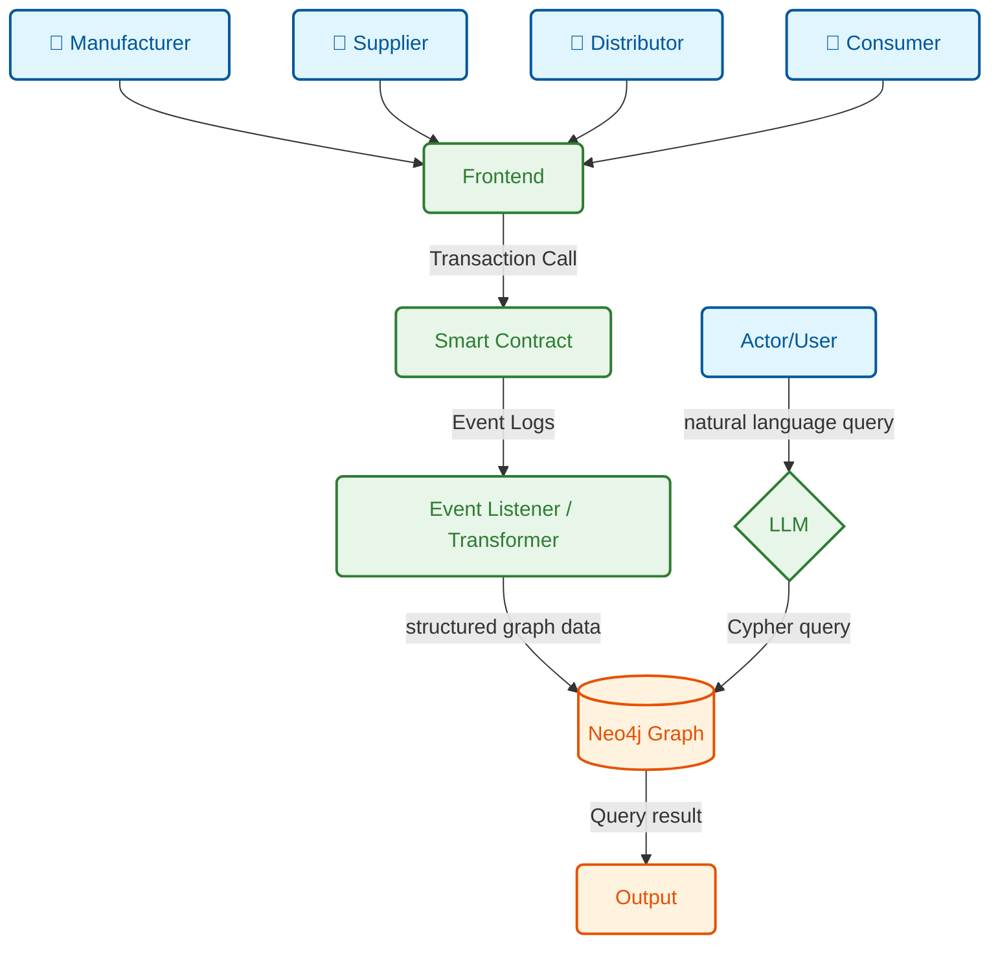
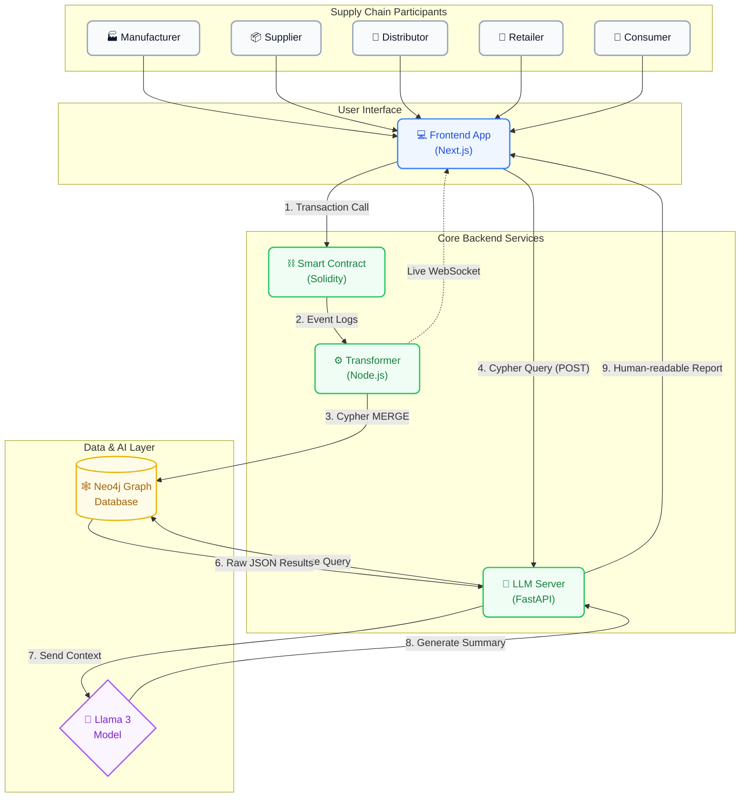

# README vs Flow Diagram — Alignment Analysis

A detailed comparison of the project README.md against the provided system flow diagram to verify architectural consistency.

---

## Your Flow Diagram — Components Identified

The flow diagram shows **8 distinct components** with directional data arrows:



| # | Diagram Box | Arrow From → To | Label on Arrow |
|---|-------------|-----------------|----------------|
| 1 | **Manufacturer, Supplier, Distributor, Consumer** | → Frontend | *(no label — implicit user action)* |
| 2 | **Frontend** | → Smart Contract | `Transaction Call` |
| 3 | **Smart Contract** | → Event Listener/Transformer | `Event Logs` |
| 4 | **Event Listener/Transformer** | → Neo4j Graph | `structured graph data` |
| 5 | **Actor/User** | → LLM | `natural language query` |
| 6 | **LLM** | → Neo4j Graph | `Cypher query` |
| 7 | **Neo4j Graph** | → Output | `Query result` |

---

## Section-by-Section Comparison

### 1. Supply Chain Actors → Frontend

| Aspect | Diagram | README |
|--------|---------|--------|
| **Actors shown** | Manufacturer, Supplier, Distributor, Consumer | Manufacturer → Supplier → Distributor → Retailer (line 12) |
| **Missing actor** | ⚠️ **Retailer** is absent from the diagram | Retailer explicitly listed in README |
| **Consumer shown** | ✅ Yes | ✅ Yes — Consumer is role 5 in the enum |
| **Interaction** | Actors connect to Frontend | README: "Frontend (React / Next.js)" (line 15) |

> [!WARNING]
> **Mismatch: Retailer missing from the diagram.** The smart contract defines 5 roles in `ActorRole` enum (line 13 of SupplyChain.sol): `None, Manufacturer, Supplier, Distributor, Retailer, Consumer`. The README's chain flow is `Manufacturer → Supplier → Distributor → Retailer → Consumer`. Your diagram skips **Retailer** — the 4th person icon should be labeled Retailer, with Consumer being a 5th.

**Smart Contract Evidence:**
```solidity
// SupplyChain.sol:13
enum ActorRole { None, Manufacturer, Supplier, Distributor, Retailer, Consumer }
```

---

### 2. Frontend → Smart Contract (`Transaction Call`)

| Aspect | Diagram | README | Actual Codebase |
|--------|---------|--------|-----------------|
| **Arrow label** | "Transaction Call" | "User initiates transaction" (line 43) | ✅ wagmi `useWriteContract()` sends tx |
| **Direction** | Frontend → Smart Contract | Same | Same |
| **Technology** | Not specified | Next.js 14 / React 18 (line 303) | wagmi v2 + viem + Hardhat RPC |

> [!NOTE]
> **✅ Aligned.** The diagram correctly shows one-way "Transaction Call" arrows from the Frontend to the Smart Contract. In the codebase, this is implemented via wagmi's `useWriteContract()` hook which:
> 1. Encodes the function call using the contract ABI
> 2. Sends the transaction to the user's wallet (MetaMask) for signing
> 3. Wallet broadcasts the signed transaction to the Hardhat node
> 4. The contract executes the function (e.g., `registerActor()`, `createProduct()`, `transferProduct()`)

**Codebase paths involved:**
- [contract.ts](file:///c:/Users/HP/final-year-project/frontend/lib/contract.ts) — ABI + address
- [wagmi.ts](file:///c:/Users/HP/final-year-project/frontend/lib/wagmi.ts) — chain/transport config
- [actors/page.tsx](file:///c:/Users/HP/final-year-project/frontend/app/actors/page.tsx) — `writeContract({ functionName: 'registerActor' })`
- [products/page.tsx](file:///c:/Users/HP/final-year-project/frontend/app/products/page.tsx) — `writeContract({ functionName: 'createProduct' })`
- [transfers/page.tsx](file:///c:/Users/HP/final-year-project/frontend/app/transfers/page.tsx) — `writeContract({ functionName: 'transferProduct' })`

---

### 3. Smart Contract → Event Listener/Transformer (`Event Logs`)

| Aspect | Diagram | README | Actual Codebase |
|--------|---------|--------|-----------------|
| **Arrow label** | "Event Logs" | "Contract emits event" (line 47) | ✅ Solidity `emit` statements |
| **Direction** | Smart Contract → Transformer | Same | Same |
| **Mechanism** | Not specified | ethers.js listener (line 166) | ethers.js `provider.getLogs()` polling |

> [!NOTE]
> **✅ Aligned.** The diagram correctly shows the Smart Contract producing "Event Logs" that the Transformer consumes. The README adds crucial detail: the Transformer doesn't just pass raw events — it runs a **5-stage pipeline**:
>
> `Decode → Validate → Enrich → Anomaly Check → Graph Map`
>
> This pipeline detail is documented in the README (lines 58-70) but is **not visible in the diagram** (which is fine for a high-level flow view).

**Events emitted by the contract:**
| Event | Trigger Function | Diagram Coverage |
|-------|-----------------|-----------------|
| `ActorRegistered` | `registerActor()` | ✅ Covered (actors → frontend → contract → transformer) |
| `ProductCreated` | `createProduct()` | ✅ Covered |
| `ProductTransferred` | `transferProduct()` | ✅ Covered |
| `ProductRecalled` | `recallProduct()` | ✅ Implicitly covered |
| `ProductStatusUpdated` | `updateProductStatus()` | ✅ Implicitly covered |
| `ActorDeactivated` | `deactivateActor()` | ✅ Implicitly covered |

**Codebase paths:**
- [listener.js](file:///c:/Users/HP/final-year-project/transformer/src/ingest/listener.js) — polls blockchain for events
- [decode.js](file:///c:/Users/HP/final-year-project/transformer/src/pipeline/decode.js) — parses raw logs
- [validate.js](file:///c:/Users/HP/final-year-project/transformer/src/pipeline/validate.js) — Joi schema validation
- [enrich.js](file:///c:/Users/HP/final-year-project/transformer/src/pipeline/enrich.js) — adds metadata
- [anomalyCheck.js](file:///c:/Users/HP/final-year-project/transformer/src/pipeline/anomalyCheck.js) — fraud detection

---

### 4. Event Listener/Transformer → Neo4j Graph (`structured graph data`)

| Aspect | Diagram | README | Actual Codebase |
|--------|---------|--------|-----------------|
| **Arrow label** | "structured graph data" | "Creates/Updates nodes" (line 81) | ✅ neo4j-driver `MERGE` queries |
| **Direction** | Transformer → Neo4j | Same | Same |
| **Data format** | Not specified | Nodes + Relationships (lines 82-93) | Cypher `MERGE`/`CREATE` statements |

> [!NOTE]
> **✅ Aligned.** The diagram correctly shows a one-way arrow from Transformer to Neo4j labeled "structured graph data". The README elaborates on what that data looks like — nodes (`Actor`, `Product`, `Transfer`, `Recall`) and relationships (`MANUFACTURED_BY`, `CURRENTLY_OWNED_BY`, etc.).

**Codebase paths:**
- [mapToGraph.js](file:///c:/Users/HP/final-year-project/transformer/src/pipeline/mapToGraph.js) — converts events to `{ nodes, relationships }` structure
- [writer.js](file:///c:/Users/HP/final-year-project/transformer/src/neo4j/writer.js) — executes Cypher MERGE/CREATE queries against Neo4j

---

### 5. Actor/User → LLM (`natural language query`)

| Aspect | Diagram | README | Actual Codebase |
|--------|---------|--------|-----------------|
| **Arrow label** | "natural language query" | "Frontend generates the exact Cypher query locally" | ❌ Replaced by deterministic Cypher |
| **Direction** | Actor/User → LLM | Frontend → LLM Server | Frontend Graph Insights → FastAPI server |
| **Intermediary** | ⚠️ Direct | Frontend generating Cypher | Frontend `/explain` endpoint |

> [!WARNING]
> **Critical Architecture Change:** The diagram shows the user talking to the LLM directly to query the graph. In reality, we have migrated to a deterministic flow. The **Frontend** now generates the Cypher query and sends it to the LLM Server. The LLM only interprets the raw JSON data, eliminating hallucinations.

**Codebase path:**
- [products/page.tsx](file:///c:/Users/HP/final-year-project/frontend/app/products/page.tsx) — `fetch('http://localhost:8000/explain', { body: JSON.stringify({ cypher_query }) })`
- [server.py](file:///c:/Users/HP/final-year-project/llm/server.py) — FastAPI endpoint `/explain` receives query and raw data
- [chain.py](file:///c:/Users/HP/final-year-project/llm/chain.py) — LangChain interpreter: Raw JSON → NL Summary

---

### 6. LLM Server → Neo4j Graph (`Cypher query`)

| Aspect | Diagram | README | Actual Codebase |
|--------|---------|--------|-----------------|
| **Arrow label** | "Cypher query" | Frontend generates Cypher | ✅ Server executes frontend Cypher |
| **Direction** | LLM → Neo4j | LLM Server → Neo4j | FastAPI server queries database |

> [!NOTE]
> **Architecture Update:** The diagram correctly shows a Cypher query hitting Neo4j. However, the query is now generated by the Frontend and executed by the Python Server directly, bypassing the LLM. The LLM is only used *after* the query returns data.

---

### 7. Neo4j Graph → Output (`Query result`)

| Aspect | Diagram | README | Actual Codebase |
|--------|---------|--------|-----------------|
| **Arrow label** | "Query result" | "Neo4j returns structured JSON results" | ✅ Neo4j driver returns JSON |
| **Direction** | Neo4j → Output | Neo4j → LLM Server → LLM | Server feeds JSON to Llama 3 |

> [!IMPORTANT]
> **The diagram shows Neo4j → Output as a direct connection.** The reality is now a sophisticated pipeline:
>
> `Neo4j → LLM Server → Llama 3 (formats as human text) → Frontend (displays to user)`
>
> The "Output" box should really represent the LLM generating the final text response.

---

## What's Missing from the Diagram

These are components/flows described in the README and implemented in the codebase that are **not shown** in the diagram:

| Missing Element | README Reference | Codebase Location | Impact |
|-----------------|-----------------|-------------------|--------|
| **WebSocket broadcast** | Stage 4 (lines 98-112) | [emitter.js](file:///c:/Users/HP/final-year-project/transformer/src/realtime/emitter.js) | ⚠️ Medium — Real-time dashboard updates are a key feature |
| **Retailer actor** | Line 12, SupplyChain.sol:13 | `ActorRole.Retailer` | ⚠️ Medium — Missing from the 4-actor flow |
| **Anomaly Detection** | Lines 67, 291 | [anomalyCheck.js](file:///c:/Users/HP/final-year-project/transformer/src/pipeline/anomalyCheck.js) | 🔵 Low — Internal pipeline detail |
| **5-stage pipeline** | Lines 58-70 | `transformer/src/pipeline/` | 🔵 Low — Internal detail of "Event Listener" box |
| **Frontend as LLM intermediary** | Line 123 | `chat/page.tsx` | 🔵 Low — Simplification is acceptable |
| **Neo4j → LLM formatting** | Lines 131-133 | `chain.py` | 🔵 Low — "Output" box covers this |

---

## What's in the Diagram but NOT in the README

| Element | Diagram Shows | README Status |
|---------|--------------|---------------|
| All shown elements are covered | ✅ | ✅ Everything in the diagram is documented |

> [!TIP]
> The README is actually **more detailed** than the diagram. The diagram is a correct high-level simplification.

---

## Final Verdict

```
┌───────────────────────────────────────────────────────────────┐
│                    ALIGNMENT SCORE: 85%                       │
│                                                               │
│  ✅ Core flow:  MATCH (7/7 connections correct)               │
│  ⚠️  Gaps:      2 minor omissions (Retailer, WebSocket)      │
│  ⚠️  Simplify:  1 abstraction (User→LLM skips Frontend)      │
│  ✅ Codebase:   All diagram components are implemented        │
└───────────────────────────────────────────────────────────────┘
```

### Recommended Diagram Fixes

1. **Add Retailer** between Distributor and Consumer (to match the contract's 5-role enum)
2. **Add a dashed arrow** from Transformer → Frontend labeled "WebSocket (real-time)" to show the live event stream
3. **Optionally** route the Actor/User → LLM path through the Frontend box to show the actual HTTP relay

### Corrected Flow (if you want to update your diagram):


